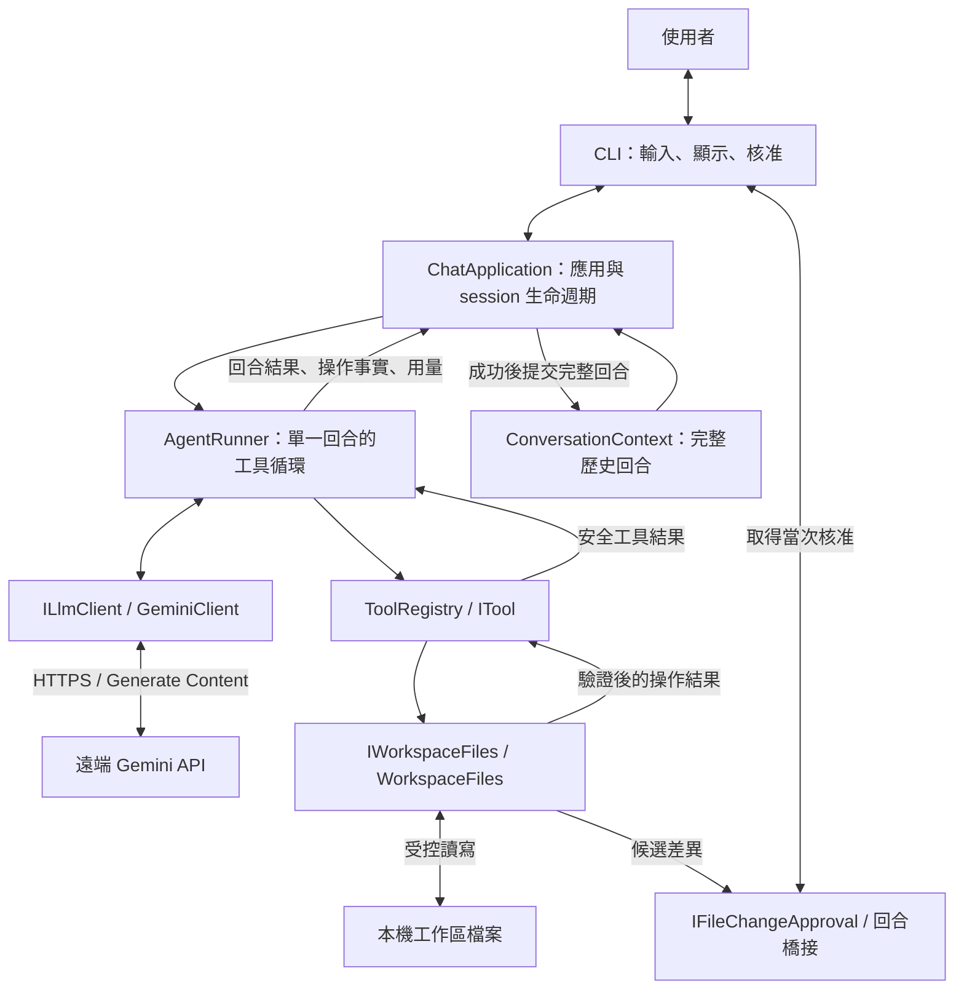
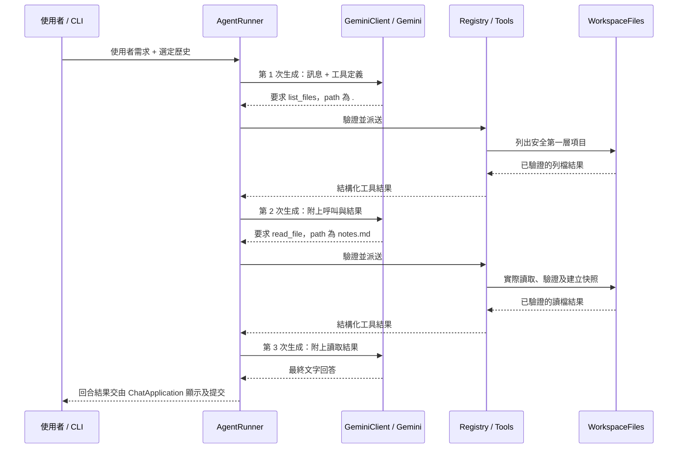

# 從聊天程式到 AI Agent：AIAgent 架構與開發分享

> 適用：30～60 分鐘技術分享｜對象：具備基本 C# 與 API 呼叫概念的開發者
>
> 整理日期：2026-10-23。內容依據目前原始碼、[總規格](SPEC.md)與 [01～07 子規格](specs/)。本文件介紹架構及開發思路，範例流程為教學示意，未在本次文件工作中重新執行產品、真人終端機或真實 Gemini 驗收。

## 1. 分享目標與時間安排

這份分享用一個「能聊天，也能受控讀寫文字檔」的 CLI，說明如何逐步開發 AI Agent。聽眾不需要先學大型 Agent 框架；先掌握模型、工具、Context 與執行循環如何合作，就能理解整個系統。

分享結束時，聽眾應能回答三件事：

- 模型提出的工具呼叫，如何成為一次可驗證的本機操作？
- 對話歷史、工具結果、使用者確認與錯誤狀態，由哪些元件負責？
- 如何把 Agent 拆成能逐步開發、測試與驗收的小階段？

| 主題 | 30 分鐘版 | 60 分鐘版 | 對應章節 |
|---|---:|---:|---|
| 從聊天到 Agent、專案定位 | 3 分鐘 | 5 分鐘 | 第 2 章 |
| 整體架構與模組分工 | 5 分鐘 | 8 分鐘 | 第 3 章 |
| 工具與 Agent 循環 | 6 分鐘 | 10 分鐘 | 第 4 章 |
| Context 與完整回合 | 3 分鐘 | 5 分鐘 | 第 5 章 |
| 檔案修改、預覽與核准 | 5 分鐘 | 10 分鐘 | 第 6 章 |
| 權限、資料保護與用量 | 3 分鐘 | 6 分鐘 | 第 7 章 |
| 分階段開發與測試 | 2 分鐘 | 5 分鐘 | 第 8～9 章 |
| 流程示範 | 2 分鐘 | 6 分鐘 | 第 10 章 |
| 問答 | 1 分鐘 | 5 分鐘 | 依現場提問 |
| **合計** | **30 分鐘** | **60 分鐘** | |

30 分鐘版以架構圖、工具循環及一次精確替換為主；60 分鐘版再展開工具配對、衝突、故障測試與示範。第 11 章是分享後的原始碼閱讀索引，可作講義使用。

## 2. 先建立概念：聊天程式如何走向 Agent？

### 2.1 本專案的定位

AIAgent 是以 **C#／.NET 10 Console** 開發的本機 CLI，透過 **Google.GenAI SDK** 呼叫 Gemini。模型服務在遠端，本機程式負責終端機、工作區與檔案操作。

使用者可以要求它說明文字、列出檔案、讀取文件，或在確認差異後建立及修改 UTF-8 文字檔。本專案採原生 function calling，以結構化工具名稱和參數表達操作要求。

| 層次 | 發生什麼事 | 本專案對應 |
|---|---|---|
| 文字聊天 | 使用者送訊息，模型產生回答。 | `GeminiClient` 與 CLI。 |
| 工具呼叫 | 模型要求某個已公布的功能，並提供結構化參數。 | `LlmToolCall`、`ToolRegistry` 與各個 `ITool`。 |
| Agent 循環 | 程式執行合規工具，將結果送回模型，讓模型決定下一步或完成回答。 | `AgentRunner`。 |

可以用這個組合介紹本專案：

```text
AI Agent = 模型理解與選擇下一步
         + 可執行的工具
         + 對話與工具 Context
         + 有停止條件的協調流程
         + 權限、核准與結果驗證
```

例如「把 notes.md 的草稿改成正式版」，模型負責提出 `read_file`、`replace_text`；本機程式負責判斷路徑、驗證替換、顯示差異及執行寫入。檔案是否修改成功，以本機讀回核對的結果為準。

### 2.2 為什麼從 CLI 開始？

CLI 讓初期開發集中在 API、Context、工具與控制流程；同一程序也能處理本機檔案。這次先完成核心能力，日後若增加桌面或網頁介面，可透過既有契約提供輸入、顯示與核准。

目前產品只有四個檔案工具，沒有任意 shell、檔案刪除、網頁搜尋、向量資料庫、多 Agent 或背景任務。這個範圍足以完整展示一個 Agent 從理解需求到實際操作的流程。

## 3. 整體架構：一個程序，分開六種責任

### 3.1 執行時的合作關係

下圖表示主要互動與資料流；`Security` 的檢查會跨越輸入、模型、工具、候選內容及顯示邊界。



工具參數與讀取結果在本機處理，合規的工具結果才會進入後續模型請求。API Key 走認證用途，不放進模型 Context；需要模型處理的聊天及選取檔案內容可能傳到 Gemini。

### 3.2 資料夾與元件分工

| 位置 | 主要元件 | 分享時抓住的責任 |
|---|---|---|
| `Program.cs` | 啟動與依賴組裝 | 建立服務、移交 session、路由中斷與回傳退出碼。 |
| `Cli/` | `ConsoleChatInteraction`、`ChatInputReader`、`ChatDisplay` | 終端機輸入、安全顯示、Ctrl+C 與寫入核准。 |
| `Core/` | `Bootstrapper`、`ChatApplication`、`AgentRunner`、`ConversationContext` | 啟動、應用生命週期、單回合循環及歷史管理。 |
| `Llm/` | `GeminiClient`、`GeminiProtocol`、`GeminiTransport` | SDK 轉接、協定、HTTP 邊界與模型結果分類。 |
| `Tools/` | `ToolRegistry`、四個檔案工具 | 公布工具定義、驗證參數、派送與投影結果。 |
| `Workspace/` | `WorkspaceFiles`、`ReadSnapshotStore`、`MacWorkspaceFileSystem` | 工作區限制、文字讀寫、快照、差異及實際檔案核對。 |
| `Configuration/`、`Security/` | `SettingsLoader`、`SessionSecrets`、`SensitiveDataPolicy` | 非機密設定、認證資料生命週期與各邊界的敏感內容處理。 |

尤其要分清楚兩個協調器：

- **`ChatApplication` 管整個應用**：等待輸入、本機指令、session、換 Key、最終回合提交與資源釋放。
- **`AgentRunner` 管一次回合**：呼叫模型、依序執行工具、追加結果、限制生成次數，最後回傳結果。

Runner 借用模型與工具服務，不直接操作 Console，也不直接提交歷史。這讓 CLI 狀態與模型／工具循環可以各自理解及測試。

### 3.3 用介面隔離變動與測試

模型呼叫由核心的 `ILlmClient` 定義，`GeminiClient` 實作；工具操作工作區時，透過 `IWorkspaceFiles`。Gemini 的 SDK 型別留在 `Llm/` 內處理，核心只使用自己的契約。

```csharp
// 摘錄現有契約：一個模型呼叫邊界、一個工具執行邊界。
public interface ILlmClient : IAsyncDisposable
{
    Task<LlmResult> GenerateAsync(
        LlmRequest request, CancellationToken cancellationToken);
}

internal interface ITool
{
    LlmToolDefinition Definition { get; }
    Task<ToolExecutionResult> ExecuteAsync(
        JsonElement arguments, CancellationToken cancellationToken);
}
```

測試可以注入假模型、假終端機與可控制的檔案系統。未來若更換模型供應商，也有明確轉接位置；新供應商的協定與驗收仍須另行實作。

## 4. Agent 的核心：模型 → 工具 → 結果 → 再次生成

### 4.1 工具是一份明確的能力契約

目前正式工具依序如下。工具定義包含名稱、用途及參數 Schema；本機仍會嚴格驗證實際參數。

| 工具 | 參數 | 功能與必要條件 |
|---|---|---|
| `list_files` | `path` | 列出指定目錄第一層的安全項目；工作區根用 `.`。 |
| `read_file` | `path` | 完整讀取合規的小型 UTF-8 文字檔，並建立本機快照。 |
| `create_file` | `path`、`content` | 父目錄已存在、目標不存在；預覽及核准後建立。 |
| `replace_text` | `path`、`old_text`、`new_text` | 必須有有效讀取快照，舊文字非空且恰好匹配一處；預覽及核准後替換。 |

例如 `read_file` 的參數 Schema：

```json
{
  "type": "object",
  "properties": { "path": { "type": "string" } },
  "required": ["path"],
  "additionalProperties": false
}
```

模型可以提出 `{"path":"notes.md"}`。`ToolRegistry` 只派送已登錄名稱；工具再檢查必填、型別、額外及重複欄位，工作區接著檢查路徑與內容。Schema 協助模型產生合規要求，程式碼負責落實限制。

### 4.2 用一次讀檔需求說明循環

使用者提出：「先列出工作區檔案，再讀取 notes.md，整理重點。」一種可能流程是：



這是教學示意，模型也可能在同一回應提出多個呼叫。程式一律依原順序執行；工具存在也不代表每次聊天都必須使用工具。

### 4.3 循環一定要有停止條件

`AgentRunner` 的核心順序可濃縮如下；正式實作另外處理敏感資料、協定、取消與本機操作事實。

```text
取得歷史與當前使用者訊息
→ 檢查取消，開始一次模型生成
→ 記錄用量，驗證模型結果
→ 最終文字：回傳候選完成回合
→ 工具呼叫：整批檢查結構、敏感資料及生成額度
→ 依序驗證並執行工具，必要時等待使用者核准
→ 記錄本機結果，建立完整配對的工具結果訊息
→ 附回當前 Context，進入下一次生成
```

每個使用者回合最多 **5 次 `GenerateAsync`**。第 5 次可以提供最終回答；若仍要求工具，該批工具全部不執行，也不再送第 6 次生成。五次生成可以包含多個工具呼叫，兩者的計數不同。

本專案自行控制循環，關閉自動續傳並限制 SDK 傳輸嘗試，不自動重試。未知工具與一般參數錯誤可形成受控結果，讓模型在剩餘額度內修正；取消、敏感資料、非法協定、明確拒絕核准等情況則停止。

## 5. Context：保存完整回合與工具協定

### 5.1 一個回合可能包含多次模型請求

`ConversationContext` 只保留最近 **5 個完整成功回合**，每次另外加上當前使用者訊息及工具鏈。

```text
純文字回合：使用者 → 模型最終回答

工具回合：使用者
          → 模型工具呼叫 A、B
          → A、B 的全部對應結果
          → 模型工具呼叫 C
          → C 的對應結果
          → 模型最終回答
```

當第 6 回合開始時，仍可帶前 5 個完整回合；成功提交後，再淘汰最舊一回合。失敗或取消的當前鏈不提交；需要安全重設時，會共同清除歷史與讀取快照。

這個設計同時控制歷史成長，並避免留下只有工具呼叫、沒有工具結果的紀錄。一般工具被拒絕後，模型若正常解釋並結束，仍可形成完整對話；操作本身的拒絕狀態照實保留。

### 5.2 顯示文字與協定紀錄分開

模型回應除了可見文字，還可能有工具呼叫、識別資料與 API 要求保留的中繼資料。`GeminiClient` 保存完整模型 Content，供後續合法請求續用；CLI 只取得適合顯示的文字及安全狀態。

工具結果依 **原始位置 `PartIndex`、名稱及有提供時的 `CallId`** 配對。同名工具可以出現多次，不能只用工具名稱當索引而覆蓋先前結果。

分享時說明「完整紀錄要保存、每個呼叫要有對應結果」即可；thought signatures 等協定細節可留待進階問答，不展示內部提示或原始協定內容。

### 5.3 三種記憶體資料各有用途

| 資料 | 用途 | 生命週期重點 |
|---|---|---|
| 對話 Context | 讓模型接續理解需求與工具往返。 | 有限完整回合；歷史中的檔案文字代表當時資料。 |
| 讀取快照 | 提供修改前的原始 bytes、BOM、指紋與檔案身分基準。 | 有限容量；修改仍須重新讀取核對磁碟，不能只相信快照。 |
| 用量統計 | 保存本回合與程序累計的數值。 | `/clear` 與換 Key 保留程序累計，退出才丟棄。 |

因此 `/clear` 清除對話、快照等記憶體狀態，已經寫入的檔案仍然存在。

## 6. 從讀檔到修改：加入人的核准與寫入驗證

### 6.1 精確替換的完整路徑

以「把 notes.md 中唯一一處『草稿』改成『正式版』」為例：

```text
read_file：實際讀取並建立快照
→ replace_text：驗證參數，取得目前 session 的快照
→ 重新讀取：確認檔案 bytes、身分及權限與基準一致
→ 精確匹配：old_text 非空，而且恰好出現一處
→ 建立候選：保留未修改 bytes、BOM 與換行
→ 本機差異預覽：顯示實際候選的完整變更
→ 使用者當次輸入 y / yes
→ 最後重驗：檔案與路徑仍符合基準
→ 同目錄暫存、發布到目標、讀回核對
→ 回報本機結果，允許時再交給模型形成回答
```

若舊文字找不到或出現多處，直接拒絕，不猜測使用者要改哪一處。若使用者在預覽期間用編輯器修改檔案，最後重驗會偵測衝突並停止，後續需要重新讀檔與提案。

`create_file` 的基準則是「目標不存在」；它不要求先讀取檔案，也不會自動建立父目錄或覆蓋已存在目標。

### 6.2 核准必須來自當下互動

差異由 `FileChangePreviewBuilder` 根據實際原文與候選產生，包含目標、bytes、BOM、增刪行及行尾標記。核准由 `IFileChangeApproval` 經回合橋接交給 CLI，工作區本身不直接讀 Console。

- 每筆變更都要自己的完整預覽及當次 `y`／`yes`，大小寫不拘。
- 空白或 `n`／`no` 拒絕並停止本回合；其他無效選擇重問。
- 模型文字、檔案中的「已同意」或預先輸入的 `yes` 都不能授權寫入。
- CLI 在忙碌輸入與核准輸入間移交讀取權，任一時刻只有一個讀取者。

這就是本專案的 human-in-the-loop：模型能提出候選，使用者能在可核對的變更前做決定。核准後仍要重驗，才進入真正寫入。

### 6.3 寫入結果需要三種狀態

| `FileWriteState` | 代表的本機事實 | 對使用者的意義 |
|---|---|---|
| `NotApplied` | 本次未開始發布，或能明確證明未套用。 | 這次操作未套用；外部程序仍可能改過檔案。 |
| `Verified` | 已發布，且目標身分、權限與完整 bytes 讀回核對成功。 | 可以回報「已寫入並核對」。 |
| `Unconfirmed` | 已嘗試發布，但無法證明完整核對成功。 | 停止後續操作，明示結果未確認，不能盲目重試。 |

實作以一份核准後才建立的同目錄暫存檔承接候選，再透過 macOS 原生檔案發布操作處理目標，最後讀回驗證。新檔採不可覆蓋發布；替換保留未改內容與普通權限位元，但沒有完整 metadata 保留或復原機制。

兩個值得在分享時提出的例子：

1. **寫入成功後模型斷線**：本機 `Verified` 仍成立，另外回報模型失敗，不能自動重寫。
2. **先同意 A，再拒絕 B**：A 保留已寫事實，B 未套用，其餘停止。這是逐檔操作，沒有多檔交易或自動回復。

Ctrl+C 會取消後續流程；發布已開始時仍須完成查核與收尾，不能把已寫入結果說成沒有發生。

## 7. 讓 Agent 可控：權限、敏感資訊與資源上限

### 7.1 模型選擇操作，程式執行權限檢查

四個工具統一經過 `WorkspaceFiles`，只接受目前固定工作區內的合規相對路徑。檢查包括 `..`、絕對路徑、敏感名稱、沿途符號連結、普通檔案種類、編碼、大小與狀態變動。

檔案內容即使要求讀取憑證或執行命令，仍然是資料；後續模型提出的每個工具呼叫都要重新通過相同檢查。應用指示協助模型配合，實際存取控制由程式碼落實。

這是應用層限制，目前檔案系統轉接器使用 macOS 實作；不能據此宣稱具備完整作業系統沙盒、消除所有檔案競態，或已支援所有平台。

### 7.2 Key 與敏感內容有獨立邊界

Key 只由終端機隱藏輸入，保存在程序記憶體，用於官方 HTTPS 認證。產品不從命令列、環境變數或檔案讀 Key，非機密 `appsettings.json` 只保存模型設定。

`SensitiveDataPolicy` 在模型輸入、工具參數、讀取結果、完整寫入候選及顯示邊界檢查當前 Key。敏感輸入或候選會被拒絕；顯示另做遮蔽與終端機控制字元處理。這是針對當前 Key 的保護，沒有宣稱可辨識所有其他或變形憑證。

開發流程另有 Python 掃描器，檢查完整 Git index 或指定發布目錄；選用 hook 可在一般提交時呼叫它。它與執行期檢查分工不同，也不能由 `.gitignore` 取代。

### 7.3 預算控制先從有限資源做起

| 控制項 | 目前上限 | 解決的問題 |
|---|---|---|
| 每回合生成 | 5 次 | 工具循環不能無限延續。 |
| 已完成歷史 | 5 個完整回合 | 對話不無限成長。 |
| 單檔／完整寫入候選 | 128 KiB，包含 BOM | 有界處理文字資料。 |
| 列檔 | 最多回傳 200 筆、掃描 4096 個直接子項目 | 列舉工作量與結果有界。 |
| 單份工具結果 | 192 KiB 的完整 UTF-8 JSON | 限制回填資料及跳脫膨脹。 |
| 讀取快照 | 20 份、原始 bytes 合計 1 MiB | 不形成無限本機快取。 |
| 完整差異預覽 | 64 KiB UTF-8 | 無法完整顯示就拒絕，要求縮小變更。 |
| 完整模型請求 | 256 KiB 的實際 SDK JSON body | 歷史、工具、結果及中繼資料一併計量。 |
| 每次模型生成 | 8192 output tokens、120 秒 | 限制單次輸出與等待；核准沒有逾時自動同意。 |

這些單位不同：bytes、回合數與 token 不能直接互換。單一檔案合格，仍可能因工具結果或完整模型請求超限而停止；程式不偷偷裁切工具鏈或另送摘要補救。

`UsageAccumulator` 分開記錄五欄 token 用量，以及生成次數與傳輸嘗試數。缺值標示不可得或不完整，不能當零；Total 採 API 回報值，不自行加總其他欄位補算。本專案的「預算」目前指資源限制，沒有金額上限或精確費用估算。

## 8. 如何開發：三個里程碑、七份子規格

整個系統可以依下列順序堆疊。每一步都有可獨立理解的成果，再接入下一層。

| 里程碑 | 子規格 | 開發成果 | 這一步要學到什麼？ |
|---|---|---|---|
| 可以聊天 | [01：啟動與 Key](specs/01-bootstrap-and-key.md) | 參數、非機密設定、工作區確認、隱藏輸入及 session。 | 先定義輸入、認證與資源所有權。 |
| 可以聊天 | [02：Gemini 用戶端](specs/02-gemini-client.md) | `ILlmClient`、SDK 轉接、協定保存與受控錯誤。 | 把外部模型服務包在可測試的邊界。 |
| 可以聊天 | [03：CLI 與 Context](specs/03-cli-and-context.md) | 持續對話、指令、完整歷史、取消、換 Key 與累計用量。 | 先完成穩定的文字聊天生命週期。 |
| 可以讀檔 | [04：工作區與唯讀工具](specs/04-workspace-and-read-tools.md) | 統一路徑檢查、列檔、讀檔與快照。 | 先把檔案能力做對，再讓模型使用。 |
| 可以讀檔 | [05：工具循環](specs/05-agent-loop.md) | Registry、Schema、派送、配對與五次生成限制。 | 串起模型與真實工具，形成 Agent。 |
| 可以修改 | [06：檔案編輯與核准](specs/06-file-edit-and-approval.md) | 精確替換、建檔、預覽、核准、衝突與讀回。 | 為有副作用的操作建立人與程式的確認關卡。 |
| 可以修改 | [07：預算與整體驗收](specs/07-budget-and-acceptance.md) | 限制／用量整合測試、提交／產物掃描及選用 hook。 | 把模組完成接到可重現的整體交付門檻。 |

開發節奏是「固定當前子規格 → 實作相關契約及功能 → 驗證成功、拒絕、取消與故障 → 保留證據 → 接下一階段」。例如第 04 份先做好讀取入口，第 05 份才讓模型透過正式工具使用它。

目前 01～06 的產品功能，以及 07 的整合測試、掃描器和選用 hook 都已存在。總規格與早期子規格保留了撰寫當時的「待實作」敘述；讀取進度時應對照目前程式碼及 README。

## 9. 測試策略：驗證操作事實與控制流程

模型輸出會變動，因此自動測試用可控制回應驗證程式的責任。重點包括實際 API 呼叫次數、工具順序、結果配對、核准次數、檔案 bytes，以及失敗後有沒有重複副作用。

| 測試層 | 方法 | 主要證明什麼？ |
|---|---|---|
| 核心流程 | 假 `ILlmClient`、假互動及可控制服務 | 五次上限、完整回合、取消及停止。 |
| SDK 邊界 | 真實 SDK + 假 HTTP handler | 實際序列化、工具協定、認證位置、請求大小與錯誤分類。 |
| 檔案整合 | 隔離暫存工作區 + 真實檔案；故障點注入替身 | UTF-8／BOM／換行、衝突、發布與讀回事實。 |
| 終端機 | `terminal_smoke.py` 的 PTY 自動操作 | 隱藏輸入、核准讀取權交接、Ctrl+C／EOF 與終端機復原。 |
| 開發掃描 | Python unittest + 隔離 Git／產物 | 真正 index blob、固定規則、非零阻擋與唯讀性。 |
| 真人與真實服務 | 人工操作終端機與 Gemini | 當次平台的實際互動及服務往返，另留證據。 |

分享時可挑 [BudgetWorkflowTests.cs](tests/AIAgent.Cli.Tests/BudgetWorkflowTests.cs) 的三個案例講解：`BUDAC014` 驗證建立／讀取／替換與用量；`BUDAC015` 驗證第二筆拒絕後保留第一筆；`BUDAC017` 驗證寫入後模型失敗不重放。

目前 [README 最新驗證摘要](README.md#latest-validation)記錄了離線與 PTY 的既有驗證；本次製作講義未重跑。它也記錄 Release 掃描因相依 DLL 命中 BUD-S003 而受阻，以及真人終端機、真實 Gemini、x64 與人工分發檢查未驗證。固定特徵命中不等於確認真實私鑰，但現行門檻仍要求停止分發，不能把功能已實作說成整體交付已全部完成。

## 10. 分享示範：用一份筆記走完讀、改與拒絕

### 10.1 分享前準備

使用獨立、既有的示範工作區，準備 `notes.md`：

```markdown
# 分享筆記
這份文件目前是草稿。
```

依 [README 建置方式](README.md#建置與啟動)先完成建置，再從儲存庫根目錄啟動。以下佔位路徑需換成實際示範目錄：

```sh
dotnet run --project src/AIAgent.Cli/AIAgent.Cli.csproj --no-build -- --workspace "/example/agent-demo"
```

確認工作區後隱藏輸入 Key。Key 不放入命令、教材或錄影；需要真實模型的示範應事先在自己的環境驗證，另備架構圖與測試案例作流程解說。

### 10.2 示範順序與講解重點

以下是建議輸入與預期核對事項，並非本次實際執行紀錄。工具呼叫如何分批由模型當次回應決定。

| 步驟 | 建議輸入／操作 | 對聽眾說明與核對 |
|---|---|---|
| 1：讀取 | 「先列出工作區第一層檔案，再讀取 notes.md，說明內容。」 | 模型提出工具，本機讀取，工具結果再回模型。 |
| 2：修改 | 「把 notes.md 中唯一一處『草稿』改成『正式版』，保留其他內容。」 | 查看本機差異及行尾；需要時模型須重新讀檔取得快照。 |
| 3：核准 | 看完差異後，當次輸入 `y`。 | 先觀察「已寫入並核對」，再用編輯器核對實際內容。 |
| 4：拒絕 | 再要求改成另一個版本，預覽後輸入 `n`。 | 該次未套用，回合停止；前一步成功修改仍存在。 |
| 5：清除 | 執行 `/clear`，再查看示範檔案。 | 對話與快照清除，已寫 bytes 保留；程序用量也保留。 |

30 分鐘版展示步驟 2～3 即可，其餘以表格說明。60 分鐘版可加一個衝突例子：預覽時用另一個編輯器改同一檔，再同意舊候選，觀察衝突與停止；需要先排練此流程。

示範時持續對照三個問題：「模型現在要求什麼？」「本機實際做了什麼？」「程式如何證明結果？」就能把架構圖與終端機操作連在一起。

## 11. 分享後的原始碼閱讀索引

| 想理解的問題 | 建議入口 |
|---|---|
| 程式如何組裝、啟動並進入聊天？ | [Program.cs](src/AIAgent.Cli/Program.cs)、[Bootstrapper.cs](src/AIAgent.Cli/Core/Bootstrapper.cs)。 |
| 應用與單回合如何分工？ | [ChatApplication.cs](src/AIAgent.Cli/Core/ChatApplication.cs)、[AgentRunner.cs](src/AIAgent.Cli/Core/AgentRunner.cs)。 |
| 歷史及工具配對如何保持完整？ | [ConversationContext.cs](src/AIAgent.Cli/Core/ConversationContext.cs)、[ToolCallPairing.cs](src/AIAgent.Cli/Core/ToolCallPairing.cs)。 |
| 模型介面如何轉成 Gemini 協定？ | [LlmContracts.cs](src/AIAgent.Cli/Core/LlmContracts.cs)、[GeminiClient.cs](src/AIAgent.Cli/Llm/GeminiClient.cs)、[GeminiProtocol.cs](src/AIAgent.Cli/Llm/GeminiProtocol.cs)。 |
| 工具如何登錄與執行？ | [ToolRegistry.cs](src/AIAgent.Cli/Tools/ToolRegistry.cs)、[WorkspaceTools.cs](src/AIAgent.Cli/Tools/WorkspaceTools.cs)、[FileWriteTools.cs](src/AIAgent.Cli/Tools/FileWriteTools.cs)。 |
| 檔案存取與寫入如何驗證？ | [WorkspaceFiles.cs](src/AIAgent.Cli/Workspace/WorkspaceFiles.cs)、[WorkspaceFileWrites.cs](src/AIAgent.Cli/Workspace/WorkspaceFileWrites.cs)、[MacWorkspaceFileSystem.cs](src/AIAgent.Cli/Workspace/MacWorkspaceFileSystem.cs)。 |
| 差異如何交給使用者核准？ | [FileChangePreviewBuilder.cs](src/AIAgent.Cli/Workspace/FileChangePreviewBuilder.cs)、[FileChangeApprovalBridge.cs](src/AIAgent.Cli/Core/FileChangeApprovalBridge.cs)、[ConsoleChatInteraction.cs](src/AIAgent.Cli/Cli/ConsoleChatInteraction.cs)。 |
| 用量及資料保護如何獨立處理？ | [UsageAccumulator.cs](src/AIAgent.Cli/Core/UsageAccumulator.cs)、[SensitiveDataPolicy.cs](src/AIAgent.Cli/Security/SensitiveDataPolicy.cs)。 |
| 開發掃描與整合驗證從哪裡看？ | [掃描器入口](scripts/check_sensitive_content.py)、[BudgetWorkflowTests.cs](tests/AIAgent.Cli.Tests/BudgetWorkflowTests.cs)、[掃描器測試](tests/test_sensitive_content.py)、[PTY 測試](tests/terminal_smoke.py)。 |

建議第一次導讀只開啟 `Program.cs`、`ChatApplication`、`AgentRunner`、`ToolRegistry` 與寫入流程；原生檔案系統細節、完整錯誤碼及掃描器解析留給後續閱讀。這樣能在一場分享中看懂主幹，也有清楚的入口繼續深入。
