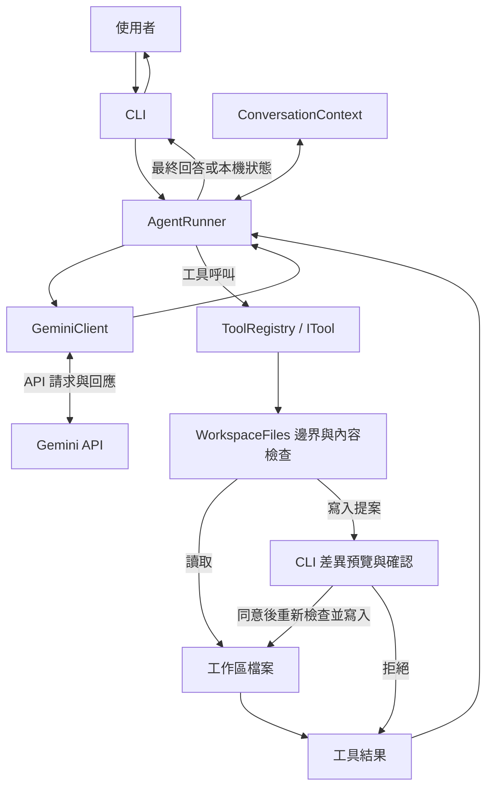

# 入門 AI Agent 開發總規格書

> 文件版本：0.2｜建立日期：2026-10-19｜修訂日期：2026-10-19｜文件狀態：開發基線
>
> 本文件描述預計開發的功能與驗收方式。目前交付物為本規格書與 `.gitignore` 排除設定，產品程式、工具與測試均尚未建立。執行期遮蔽、敏感資訊檢查與提交阻擋是後續開發要求，本次未加入程式或 Git hooks。後續依第 16 章逐份展開子規格，再進行開發。

## 第 12 份適用範圍補充（2026-10-25）

[第 12 份專案規則載入](specs/12-project-rules-loading.md) 接續第 5、6、8～15 章：確認工作區與 Key 政策就緒後，自動載入根 AGENTS.md，使用者以 /rules scope DIR 明確選擇子目錄祖先鏈；來源全文、範圍、bytes 與 SHA-256 可安全檢視。規則屬外部資料，不授予工具、認證、程序或核准權限。跨 Scope／遇新規則邊界拒絕，來源變動停止並要求明確重載、重新確認及新指示。

安全讀取、共用租約、來源世代與結果發布閘門同時涵蓋工具、計畫、Context、寫入與程序核准。既有公開 LLM 契約、工具輸入／成功資料格式、SDK 協定所有權、各項上限與 test 不支援狀態保持。規則來源不建立修改快照或本機完成證據；已完成的操作先保留事實，再撤確認，不自動重試或復原。實作與分層證據見 [README](README.md#project-rules-validation)，既有發布與人工門檻不因本功能解除。

## 第 11 份適用範圍補充（2026-10-25）

[第 11 份](specs/11-context-and-budget-management.md) 接續第9、10、14章與相關歷史限制：加入程序內摘要、必留原文備註、容量資訊、/context、/compact、/budget；成功回合不再直接淘汰。回合／程序生成預設5／100，可調1～20／1～1000；自動摘要共用一般回合額度，手動摘要計入程序總額度。clear／reset／換 Key不退款，未釘選對話為有損整理；本機計畫、證據、快照與核准仍由原來源管理。容量估算、實際SDK bytes與API用量分列，不代表模型剩餘token或費用。證據見 [README](README.md#context-budget-validation)，跨次保存、多Agent、修正循環及既有未結門檻維持各自範圍。

## 第 10 份適用範圍補充（2026-10-24）

[10：受控建置與測試](specs/10-controlled-build-and-test.md) 擴充 FUT-02；實作及分層驗證紀錄見 [README](README.md#controlled-build-validation)。正式登錄追加 `run_dotnet_task`，Plan 仍六項工具、Execute 九項；只有明確 `.csproj` 的固定 Debug build／MTP test，不提供自由 shell、額外 argv、restore 或部署。

目前 SDK 10.0.100 的 MTP 固定使用全域 `/tmp` socket；依使用者決定保留私人 IPC 邊界，產品 `test` 回報 capability_unavailable，整個第 10 階段仍未完整驗收。

確認計畫不等於核准程序。每次完整預覽後另取得新輸入同意；原生隔離不可用或布局不支援即拒絕，不回退裸跑。使用獨立發佈目錄啟動 Agent／ProcessHost；允許輸出與目前 runtime 相交時拒絕。來源與敏感位置不能寫入，建置產物與私人暫存保留，不進行批次清理。

Validation v1 保持空條件及 capability_unavailable；v2 才可要求 1～8 個精確 build／test 操作。完成依據取本機最近相符的安全程序事實；正常退出 0 不單獨證明測試實際通過。程序與檔案共用排他租約，啟動前與收尾後失效所有修改快照。程序每回合兩次／累計 300 秒；既有生成、歷史、投影、事實與 SDK body 上限不變。Unconfirmed／程序收尾失敗鎖定 session 並退出 1。

本補充只覆蓋第 10 份明示擴充；下列初版與第 09 份敘述保留歷史界線。真人、真實 Gemini、第 07 份 Release 掃描與人工分發另計，不能以程序功能實作取代其證據。

## 第 09 份適用範圍補充（2026-10-24）

[09：Plan 模式與任務清單](specs/09-plan-mode-and-task-list.md) 已實作 FUT-03，擴充本總規格第 5、8～15 章。啟動預設 Execute，沒有計畫時保留既有聊天與逐次核准；`/plan` 進入唯讀規劃，`/execute` 完整確認目前版本後等待下一則訊息，`/tasks` 顯示本機狀態。九項內建工具按模式提供：Plan 五唯讀加 submit_plan，Execute 七檔案工具加 update_task；新參數與結果契約依第 09 份，既有七工具格式不變。

計畫與證據只存記憶體，獨立於五回合歷史；本機限制 20 任務、1 在途、每項 8 個必要操作及共 256 筆事實。完成區分本機操作與模型分析，Validation 尚未提供建置測試能力。實際／保守投影各 32768 bytes、完整顯示／新結果各 65536 bytes，並保留必然收尾容量；五次生成與 262144 bytes 實際請求限制不變。清除與換 Key 不恢復核准、快照或檔案，也不重置程序用量；Plan 模式限制保留。

實作與當次離線／PTY 證據見 [README](README.md#latest-validation)。不擴充 FUT-02 程序、FUT-04 摘要預算、跨次保存或多 Agent；第 07 份發布門檻及真人／真實服務待辦繼續分列。

## 第 08 份適用範圍補充（2026-10-23）

本總規格保留初版規劃的歷史敘述。後續 [08：程式碼搜尋與局部讀檔](specs/08-code-search-and-partial-read.md) 已擴充第 11.6 節的搜尋／局部讀取方向；正式工具順序為 `list_files`、`read_file`、`create_file`、`replace_text`、`search_files`、`search_text`、`read_file_range`。新增三工具共用原工作區、安全政策、操作互斥與取消機制，沒有新增 SDK、設定、認證來源或外部程序。

搜尋採有限 glob 與單行字面文字，文字／範圍工具完整安全讀取最多 131072 bytes 後才回傳片段；新結果 JSON 最多 65536 bytes。工作量、固定忽略、分行、排序與失敗契約以第 08 份為準。搜尋不建立修改快照；文字搜尋與範圍讀取開始處理檔案時失效同檔舊快照，替換仍須重新完整 read_file 並逐次核准。五回合歷史、五次生成、既有四工具及 262144 bytes 實際模型請求限制不變。

實作與當次離線／PTY 證據見 [README](README.md#latest-validation)。第 07 份 Release 掃描阻擋與真人／真實 Gemini／人工分發待辦仍保留，不因第 08 份交付而解除。其餘未來能力不在本次範圍。

## 目錄

1. [文件導讀與名詞](#chapter-01)
2. [專案目標與使用情境](#chapter-02)
3. [CLI 與 App 的選型](#chapter-03)
4. [功能範圍與版本邊界](#chapter-04)
5. [整體架構](#chapter-05)
6. [啟動與 API Key](#chapter-06)
7. [Gemini API 整合](#chapter-07)
8. [CLI 對話操作](#chapter-08)
9. [對話紀錄與 Context](#chapter-09)
10. [Agent 工具循環](#chapter-10)
11. [檔案讀取工具](#chapter-11)
12. [檔案建立與修改](#chapter-12)
13. [工作區與操作限制](#chapter-13)
14. [Token 與成本控制](#chapter-14)
15. [錯誤處理與測試](#chapter-15)
16. [分階段開發與子規格索引](#chapter-16)

<a id="chapter-01"></a>

## 1. 文件導讀與名詞

### 1.1 目的

提供一份能逐步實作的入門架構，說明聊天程式如何透過工具，成為可以操作本機文字檔案的 Agent。適用對象是具備基本 C# 知識、希望理解 Agent 工作流程的開發者。

### 1.2 初版範圍

本文件先固定產品方向、模組邊界、關鍵行為與階段驗收。SDK 的確切版本、C# 方法簽章、完整 JSON Schema、限制數值與測試程式，於對應子規格展開時定案；不在此階段一次寫完所有開發細節。

| 名詞 | 本專案中的意思 |
|---|---|
| LLM | 語言模型，接收輸入後產生文字或工具呼叫要求。 |
| LLM API | 本機程式與 Gemini 服務交換請求、回應的介面。 |
| Agent | 組合對話、模型、工具與執行循環的本機程式。 |
| Tool | 程式預先實作並允許模型要求使用的功能，例如讀檔。 |
| Function calling | 模型以結構化資料提出工具名稱與參數的機制。 |
| Context | 本次傳給模型的資訊，包含應用指示、歷史、當前訊息與工具資料。 |
| Token | 模型處理文字等資料的計量單位，不等於固定字數。 |
| 回合 | 一次使用者訊息開始，到最終回答或明確中止為止的完整流程。 |
| 生成請求 | 一次要求 Gemini 生成回應的 API 呼叫；同一回合可能需要多次。 |
| 工作區 | 本次執行允許工具存取的單一本機資料夾及其合規子路徑。 |
| 差異預覽 | 寫入前顯示原文與新文的差異，讓使用者確認。 |

### 1.3 主要流程

先閱讀第 2～5 章理解目標與架構，再依目前開發階段閱讀相關章節。需要實作時，只展開第 16 章列出的下一份子規格，完成驗收後再向下推進。

### 1.4 模組責任

總規格管理共同約定；子規格負責個別模組的實作細節。若子規格需要改變本文件已確認的行為，必須同步修訂本文件並交代影響，避免兩份文件互相矛盾。

### 1.5 驗收條件

讀者能說明聊天、工具呼叫、實際執行與檔案寫入的差別，也能從章節索引找到每個階段需要的規格。尚未開發的功能必須明確標示為規劃，不能用完成語氣描述。

### 1.6 後續延伸

逐份增加子規格、實際操作說明與驗收證據。總規格維持為架構入口，不逐漸堆入所有程式碼與除錯紀錄。

<a id="chapter-02"></a>

## 2. 專案目標與使用情境

### 2.1 目的

建立個人本機使用、無本工具帳號系統的簡易 Agent。使用者提供自己的 Google Gemini API Key 後，可以聊天，也能透過自然語言要求讀取、建立與修改文字檔案。

### 2.2 初版範圍

初版採 C#／.NET 10 Console CLI，先在 macOS 終端機驗收。程式結構保留跨平台空間；其他作業系統須實際驗收後才列入支援範圍。

| 使用情境 | 預期行為 |
|---|---|
| 「請用簡單方式解釋這段文字」 | 直接對話，不需要使用檔案工具。 |
| 「列出目前資料夾的檔案」 | 呼叫 `list_files`，依真實結果回答。 |
| 「讀取 notes.md，告訴我重點」 | 呼叫 `read_file`，以取得的內容回答。 |
| 「把 notes.md 的『草稿』改成『正式版』」 | 讀檔、產生精確替換、顯示預覽，確認後寫入。 |
| 「建立 hello.md，內容是 Hello」 | 預覽建立內容，確認後建立新檔。 |

「不需要帳號」指本工具沒有註冊與登入功能；使用者仍須自行向 Google 取得可用的 API Key。需要模型理解的訊息與檔案內容會透過 API 傳給 Gemini，本工具需要網路連線。

### 2.3 主要流程

啟動 → 確認工作區 → 隱藏輸入 Key → 輸入需求 → 模型回答或要求工具 → 本機驗證並執行 → 必要時確認寫入 → 顯示實際結果。

### 2.4 模組責任

CLI 負責操作體驗，AgentRunner 協調步驟，Gemini 負責理解與提出操作要求，檔案工具負責驗證及實際執行。模型沒有直接存取使用者電腦的權限。

### 2.5 驗收條件

第三階段完成後，上表五個情境均可驗收；寫入結果須以實際檔案內容為準。單純產生一段聲稱「已修改」的模型回答，不算完成修改功能。

### 2.6 後續延伸

依實際使用需求增加文字搜尋、更多編輯方式或 App 介面。每個延伸功能先寫自己的子規格，不併入初版完成條件。

<a id="chapter-03"></a>

## 3. CLI 與 App 的選型

### 3.1 目的

選擇能以較少開發工作串起 Agent 核心流程的介面，讓初期精力集中在 API、對話紀錄與工具行為。

### 3.2 初版範圍

| 選項 | 入門時需要處理的工作 | 本機檔案操作 | 本次決定 |
|---|---|---|---|
| CLI | 終端機輸入輸出、取消與指令解析 | 可由同一程序直接處理 | 採用。 |
| 本機網頁 App | 網頁畫面、前後端傳輸、本機服務與檔案授權流程 | 通常由本機後端處理 | 後續評估。 |
| 桌面 App | 視窗、介面狀態、框架、打包與平台差異 | 可由桌面程序處理 | 後續評估。 |

以上是依本專案需求做的工程選擇。CLI 也需要處理權限、Key 與取消流程，但能先省下畫面與部署相關工作。

### 3.3 主要流程

先完成可獨立運作的 CLI 與核心。未來增加 App 時，讓新介面提供輸入、訊息顯示及寫入確認，再呼叫既有核心，不重新實作整個 Agent。

### 3.4 模組責任

`Console.ReadLine`、終端機色彩與確認輸入由 CLI 管理。Agent 核心與工具不得直接依賴 Console；透過最小的輸出及確認介面與 CLI 溝通。

### 3.5 驗收條件

使用模擬輸入、輸出與確認服務，能測試核心流程，無須真的操作終端機。功能程式不能全部擠在 `Program.cs`。

### 3.6 後續延伸

日後依需求選擇本機網頁或桌面介面，另訂 Key 輸入、確認視窗與檔案選取規格。初版不先建立 App 專案或 HTTP 服務。

<a id="chapter-04"></a>

## 4. 功能範圍與版本邊界

### 4.1 目的

固定初版的最小能力，避免把入門工具擴大成完整開發平台。

### 4.2 初版範圍

| 功能 | 導入階段 | 初版邊界 |
|---|---|---|
| Key 輸入與 Gemini 呼叫 | 第一階段 | 一個程序、一組當前 Key、一個設定中的模型。 |
| 多輪文字聊天 | 第一階段 | 記憶體內保存，非串流顯示。 |
| 對話歷史控制 | 第一階段 | 最近 5 個完整回合，加上當前回合。 |
| 列檔與讀檔 | 第二階段 | 單一工作區、受限輸出、UTF-8 文字。 |
| 工具循環 | 第二階段 | 手動協調、依序執行，每回合最多 5 次生成請求。 |
| 建立與修改檔案 | 第三階段 | 每次工具寫入一個檔案，先預覽並確認。 |
| 使用量顯示 | 第一階段起 | 顯示 API 有提供的用量；第三階段完成整體成本控制驗收。 |

支援內容包含 `.md`、`.txt`、`.cs`、`.json` 等 UTF-8 文字；副檔名不代表檔案一定是有效文字，仍須檢查內容與敏感檔案規則。修改 JSON、C# 等檔案不包含自動語法驗證或執行。

初版不納入任意 shell、刪除或重新命名、批次修改、Word／PDF／Excel、網頁搜尋、資料庫、向量檢索、外掛協定、多 Agent、背景任務、帳號及 App 介面。

### 4.3 主要流程

依第一、第二、第三階段導入能力。每個階段只向模型公布當時已實作且可用的工具，不能提前宣告尚不存在的工具。

### 4.4 模組責任

ToolRegistry 決定可用工具；工作區層執行檔案邊界檢查；CLI 對尚未支援的需求提供明確說明，不以其他未授權方式替代。

### 4.5 驗收條件

要求執行 shell、讀取 PDF 或刪除檔案時，不會觸發隱藏替代工具。第一階段只有聊天也能正常完成驗收，不必等待第三階段。

### 4.6 後續延伸

新增能力時，記錄導入階段、所需模組與新增驗收案例。初版範圍不因模型聲稱具備某項能力而自動擴張。

<a id="chapter-05"></a>

## 5. 整體架構

### 5.1 目的

以少量、責任明確的元件，隔離終端機、模型服務與本機檔案操作，方便逐步開發與測試。

### 5.2 初版範圍

採單一 Console 產品專案，以資料夾分工。以下為未來結構示意，本次不建立這些目錄或程式檔案。

```text
AIAgent/
├── SPEC.md
├── .gitignore              # 本機憑證、敏感輸出與建置產物排除
├── specs/                  # 依進度逐份新增的子規格
├── src/AIAgent.Cli/         # 單一 Console 產品專案
│   ├── Cli/                # 輸入、輸出、指令、確認
│   ├── Core/               # AgentRunner、對話與核心契約
│   ├── Llm/                # GeminiClient 與 SDK 轉接
│   ├── Tools/              # 登錄、參數驗證與工具
│   ├── Workspace/          # 路徑檢查、文字讀寫
│   └── Program.cs          # 組裝依賴與啟動
└── tests/                  # 對應階段的自動驗收
```

| 元件 | 責任 | 主要依賴 |
|---|---|---|
| CLI | 輸入、顯示、基本指令、Key 輸入與確認 | 核心入口。 |
| AgentRunner | 組合回合、呼叫模型、派送工具、控制停止 | 模型介面、Context、工具登錄。 |
| GeminiClient | 轉接官方 SDK、處理模型回應與用量 | `Google.GenAI`、連線設定。 |
| ConversationContext | 保存回合、依完整邊界裁切與組合請求 | 本機記憶體。 |
| ToolRegistry／ITool | 提供工具描述、驗證及執行已登錄工具 | 工作區與確認介面。 |
| WorkspaceFiles | 路徑限制、檔案檢查、讀取、受控寫入 | 本機檔案系統。 |

核心契約只保留模型呼叫介面與 `ITool` 等必要邊界。請求需帶入當前訊息、歷史、可用工具與取消訊號；回應需保留文字、工具呼叫、必要中繼資料及用量。確切型別與方法簽章由相關子規格定義。

### 5.3 主要流程



工具結果通常回傳模型形成回答；遇到取消、請求上限或 API 失敗時，由 CLI 直接顯示本機已知結果，不必再呼叫模型才能告知使用者。

### 5.4 模組責任

`Program.cs` 只做組裝與啟動。GeminiClient 不讀寫工作區；WorkspaceFiles 不呼叫模型；工具不能繞過統一確認流程。原生 SDK 的必要紀錄由轉接層保留，不為了讓顯示簡單而丟棄。

### 5.5 驗收條件

以假的模型用戶端、假的確認服務與暫存工作區，即可驗證核心流程。替換 CLI 顯示方式不應要求修改 Gemini 呼叫或檔案操作邏輯。

### 5.6 後續延伸

當模組規模真的需要時，再拆出類別庫。初版不導入多服務架構、多供應商路由或完整外掛載入機制。

<a id="chapter-06"></a>

## 6. 啟動與 API Key

### 6.1 目的

讓使用者明確知道本次可操作的資料夾，並在不儲存 Key 的情況下開始使用 Gemini。

### 6.2 初版範圍

- 啟動時可指定一個工作區；未指定時使用目前工作目錄，顯示完整路徑供確認。
- 工作區必須是既有可存取目錄，本次程序內固定不變。
- 使用終端機隱藏輸入 Key，至少拒絕空白輸入；不得以命令列參數傳入 Key。
- Key 只保存在程序記憶體，僅透過官方 HTTPS API 認證傳送，不放入 URL、模型對話、工具參數、設定檔或一般請求內容。
- 不寫入 Key 檔案、環境設定、日誌或對話紀錄；重新啟動需重新輸入。
- 真實 Key 不得提交至任何公開或私有版本庫，包含 GitHub、GitLab 與其他版本控制服務；私有版本庫也不能作為 Key 儲存位置。
- 程式碼、設定範本、文件與測試只能使用 `YOUR_GEMINI_API_KEY` 等佔位文字，或明確無認證功能的假資料；不得硬編碼真實 Key。

公開或可分享的資訊也屬於保護範圍：

| 資訊管道 | 保護要求 |
|---|---|
| 終端機、模型回覆、例外、日誌與差異預覽 | 不顯示真實 Key；後續實作使用一致的遮蔽與阻擋規則。 |
| README、規格、Issue、PR 與貼文 | 只放佔位範例，不貼上帶 Key 的指令、設定或原始請求。 |
| 截圖、錄影與測試報告 | 使用假資料或事先遮蔽；不可直接分享仍含真實 Key 的畫面與附件。 |
| 建置、發布、壓縮包與匯出產物 | 不得包含 Key、憑證檔或含認證資訊的除錯輸出；發布前另行檢查。 |

`.gitignore` 用於防範意外產生的本機檔案，不代表允許程式把 Key 寫入被忽略的檔案。初版仍維持 Key 不落地。

Key 處理遵循 [Google 的 API Key 保護說明](https://ai.google.dev/gemini-api/docs/api-key)。本機格式檢查只能判斷輸入是否合理，不能證明服務端授權有效。

### 6.3 主要流程

1. 讀取非機密設定，檢查工作區與模型設定。
2. 顯示工作區、模型及檔案內容可能作為 API 輸入的提示。
3. 隱藏輸入 Key，完成後進入對話介面。
4. 以第一個正常生成請求確認連線與授權結果，不另送固定測試訊息消耗生成用量。
5. 認證失敗時提供重新輸入或退出；模型不可用、網路錯誤與配額不足須分開回報。
6. 退出時丟棄程序中的 Key 參考與對話，不宣稱能保證受控記憶體的每一份複本都被立即覆寫。

後續實作須在模型內容送出前檢查當前 Key，涵蓋使用者訊息、選定歷史與工具結果；若發現則拒絕送出，錯誤提示也不得回顯該值。這項檢查針對模型內容，不攔阻必要的 HTTPS 認證欄位。

若懷疑 Key 已洩漏，先撤銷或更換受影響 Key，檢查 API 使用情況，再處理版本歷史、公開貼文、截圖與產物。只從目前檔案刪除文字或新增排除規則，不能視為已清除歷史與其他副本。歷史改寫須另行確認處理範圍，本次不執行。參考 [GitHub 憑證洩漏處置說明](https://docs.github.com/en/authentication/keeping-your-account-and-data-secure/removing-sensitive-data-from-a-repository)。

### 6.4 模組責任

CLI 管理隱藏輸入與重新輸入；設定模組只保存非機密資料；GeminiClient 將 Key 用於認證，回報經整理的錯誤，不回傳包含 Key 的原始請求資訊。

各模組後續共用一致的敏感資訊處理規則：對當前 Key 做精確比對，對已知憑證欄位做遮蔽；工具參數或寫入候選內容含當前 Key 時拒絕操作。當前 Key 比對不等於能偵測所有其他憑證，不宣稱能找出所有格式或經變形的秘密。

### 6.5 驗收條件

空 Key 無法送出請求；Key 不出現在畫面回顯、應用日誌、檔案與模型訊息中。用假 Key 與模擬認證回應驗證失敗流程，不以真實 Key 執行自動測試。

使用假的當前 Key，驗證它混入對話、模型輸出、錯誤訊息、工具結果與候選變更時，會被阻擋或遮蔽。範例、測試報告與公開說明只含佔位值；這些執行期案例須在相關程式完成後實測，本次不宣稱已具備自動防護。

### 6.6 後續延伸

作業系統安全儲存、環境變數讀取與記住 Key 都需另訂規格。初版不暗中新增任何 Key 持久化方式。

<a id="chapter-07"></a>

## 7. Gemini API 整合

### 7.1 目的

提供單一、可模擬的模型呼叫邊界，讓其餘模組不必了解 Gemini 的傳輸細節。

### 7.2 初版範圍

採用官方 `Google.GenAI` SDK，使用非串流回應及原生 function calling，不以自訂 XML 或解析自由文字決定要執行哪個工具。參考 [官方 SDK 說明](https://ai.google.dev/gemini-api/docs/libraries)與 [function calling 說明](https://ai.google.dev/gemini-api/docs/function-calling)。

模型名稱保存在非機密設定。Gemini 子規格須確認當時可用且支援文字、多輪對話及工具呼叫的模型、SDK 固定版本、API 模式、逾時與輸出上限。選定單一 API 模式後，所有範例與型別須一致，不混用不同世代的傳輸格式。

### 7.3 主要流程

1. 接收當前回合、選定歷史、工具定義與取消訊號。
2. 檢查模型輸入未包含當前 Key，再轉成 SDK 請求，僅將該回合需要的資料送出；Key 只用於官方 HTTPS 認證，不寫入 URL。
3. 收到文字時先經輸出遮蔽再交給核心顯示；收到工具呼叫時交給核心驗證與派送，參數含當前 Key 時拒絕執行。
4. 保留工具呼叫識別、順序與 API 要求的中繼資料，再附入工具結果。
5. 擷取 API 有提供的用量；遇到空回應、拒答、截斷或錯誤時明確分類。

若 API／模型使用 thought signatures 等中繼資料，必須依官方規格原樣保留；不要只擷取文字後自行重建整段歷史。相關行為以所選 API 的 [官方紀錄說明](https://ai.google.dev/gemini-api/docs/generate-content/thought-signatures)為準。

若回應含當前 Key，先阻止敏感原值進入待續傳的 Context，顯示遮蔽後狀態並中止當前工具鏈，依第 9 章處理不能續用的紀錄。不能為了保留 API 結構而重新傳送敏感原值，也不能改寫帶簽章的工具呼叫後假裝原紀錄仍可安全續用。

### 7.4 模組責任

GeminiClient 管理 SDK 轉接、逾時、取消與錯誤分類；AgentRunner 管理生成請求上限及工具循環。須關閉或納管 SDK 的自動工具執行與重試，避免產生未計數的額外請求。

GeminiClient 不得直接輸出 SDK 原始例外、認證標頭或完整請求傾印；錯誤與除錯資訊先經整理與遮蔽。用量統計不包含 Key。SDK 除錯輸出與發布設定也須納入後續洩漏檢查。

### 7.5 驗收條件

模擬回應可驗證純文字、單次與連續工具呼叫、中繼資料保留、空內容、拒答、輸出截斷及取消。API 回應成功只代表取得模型回應，不代表內容正確或檔案已修改。

以假 Key 驗證認證欄位仍可正常設定，但模型輸入不含該值；模擬模型與 SDK 錯誤回傳該值時，終端機、後續 Context 與測試報告均不保留原值。

### 7.6 後續延伸

串流、模型切換、進階思考設定與重試策略留待個別子規格。本階段不加入自動換模型或換供應商的備援邏輯。

<a id="chapter-08"></a>

## 8. CLI 對話操作

### 8.1 目的

建立容易理解的輸入迴圈，讓使用者能辨識目前正在等待模型、執行工具或等待寫入確認。

### 8.2 初版範圍

初版以單行文字輸入為主，每次完成一回合後才接收下一則訊息；不提供同時送出、排隊或背景執行。

| 操作 | 行為 | 是否產生模型請求 |
|---|---|---|
| 一般文字 | 開始一個對話回合 | 是。 |
| 空白輸入 | 不送出，重新提示輸入 | 否。 |
| `/help` | 顯示指令與目前能力 | 否。 |
| `/clear` | 清除對話及檔案讀取快照，保留 Key、工作區與累計用量 | 否。 |
| `/exit` 或輸入結束 | 結束程序 | 否。 |
| 未知斜線指令 | 顯示指令錯誤，不轉送模型 | 否。 |
| 等待輸入時按 Ctrl+C | 結束程序 | 否。 |
| 請求或工具執行中按 Ctrl+C | 取消當前回合，完成狀態回報後回到輸入 | 不新增請求。 |

### 8.3 主要流程

顯示輸入提示 → 解析本機指令或一般訊息 → 顯示處理中狀態 → 顯示必要工具資訊與確認 → 顯示回答或錯誤 → 回到輸入。等待寫入確認時，空白、拒絕或取消均不得視為同意。

### 8.4 模組責任

CLI 處理互動與狀態顯示；核心回報結構化事件。取消訊號必須傳到 API 與工具，且寫入一旦完成，取消不等於回復原始檔案。

### 8.5 驗收條件

本機指令不呼叫模型，等待期間不接受第二個回合。`/clear` 不會刪除使用者檔案，也不把已使用的 API 用量歸零。取消後能分辨哪些工具已執行。

### 8.6 後續延伸

多行輸入、輸入歷史、Markdown 美化與進度動畫可另行增加。先完成純文字介面，不引入完整終端機 UI 框架作為前置條件。

<a id="chapter-09"></a>

## 9. 對話紀錄與 Context

### 9.1 目的

讓模型能接續對話，同時防止歷史無限制增長，並維持工具呼叫紀錄的合法性。

### 9.2 初版範圍

對話只保存於程序記憶體。每次請求包含固定的應用指示、最近最多 5 個完整回合，以及當前回合；不自動讀取整個工作區，不自動摘要，也不保存到磁碟。

一個正常完整回合包含：使用者訊息、所有模型工具呼叫、對應工具結果與最終模型回答。「5 個回合」不是任取最後 5 則訊息，也不是每送出一次 API 就算一個回合。

### 9.3 主要流程

1. 從已完成歷史選取最新 5 個完整回合。
2. 附加當前使用者訊息，開始工具與模型循環。
3. 當前回合的工具呼叫與結果持續追加，不在中途各自裁切。
4. 回合成功結束後，以完整單位保存；超過 5 個時移除最舊回合。
5. 超出內容或模型限制時停止並提示縮小輸入、縮小讀檔範圍或 `/clear`，不偷偷啟動摘要請求。

中止或失敗回合須另記本機狀態，不偽造成成功回答。若紀錄無法形成合法工具配對，結束當前工具鏈並明示清除模型 Context 後再開新對話；已執行的檔案結果仍須先由 CLI 回報。

### 9.4 模組責任

ConversationContext 管理回合與裁切；GeminiClient 保存協定需要的原始結構；AgentRunner 管理當前回合與中止狀態。應用指示與工具權限分開管理，提示文字不能取代程式檢查。

### 9.5 驗收條件

連續超過 5 回合後，只保留最新完整回合；當前回合含多個工具步驟時不產生孤立的呼叫或結果。`/clear` 後下一次請求不包含舊對話，但檔案實際變更仍存在。

### 9.6 後續延伸

摘要、長期記憶、對話存檔與恢復另訂規格。歷史中的檔案文字不視為目前磁碟狀態，後續修改仍須以讀檔與寫入前檢查為準。

<a id="chapter-10"></a>

## 10. Agent 工具循環

### 10.1 目的

把「模型提出操作要求」與「程式實際執行操作」串起來，並確保循環能在有限請求內停止。

### 10.2 初版範圍

ToolRegistry 提供每個工具的名稱、用途與結構化參數定義，並只允許已登錄工具。每個使用者回合最多 5 次生成請求；初版工具依序執行，不做平行操作。

### 10.3 主要流程

1. 檢查取消狀態與剩餘請求次數，呼叫模型。
2. 若只有最終文字，顯示結果並結束回合。
3. 若有工具呼叫，逐一驗證名稱、參數、路徑與內容限制。
4. 唯讀工具通過檢查後執行；寫入工具通過預覽確認後才執行。
5. 為每個呼叫建立成功、失敗、拒絕或未執行的結果，維持原始配對與順序。
6. 將結果附回當前工具鏈，再呼叫模型，直到得到最終回答或觸發停止條件。

同一回應包含多個呼叫時，仍依序處理，不能忽略未處理呼叫。取消後不執行剩餘操作；已完成操作不重做。若第 5 次回應仍要求工具，停止並以本機訊息回報上限，不再開始新的檔案操作，也不額外送第 6 次請求做結尾。

回應同時包含文字與工具呼叫時，先依工具流程處理，不把其中聲稱「已完成」的文字當作實際操作結果。

### 10.4 模組責任

AgentRunner 管理循環、次數與停止；ToolRegistry 驗證及派送；工具執行具體功能。模型提出未知工具、shell 文字或不合法參數，都不能繞過登錄機制。

### 10.5 驗收條件

模擬「讀檔 → 再讀另一檔 → 回答」可完成多步流程。未知工具或參數錯誤能回傳受控失敗；持續要求工具的模型在上限內停止；取消或達上限不產生額外生成請求。

### 10.6 後續延伸

加入平行唯讀工具、更多工具種類或較完整的任務狀態機前，需另訂執行、配對與取消規則。初版不引入 Agent 框架作為必要依賴。

<a id="chapter-11"></a>

## 11. 檔案讀取工具

### 11.1 目的

讓模型按需取得本機資料，避免憑空猜測檔案內容或把整個目錄塞入 Context。

### 11.2 初版範圍

| 工具 | 最小輸入 | 預期結果 |
|---|---|---|
| `list_files` | 工作區相對目錄 `path`，根目錄使用 `.` | 該目錄第一層的相對名稱與類型，不遞迴掃描。 |
| `read_file` | 工作區相對檔案 `path` | 經驗證的 UTF-8 文字，以及必要的檔案識別資訊。 |

讀檔接受有效 UTF-8，可辨識 UTF-8 BOM；非 UTF-8、明顯二進位、敏感檔案或超出限制時拒絕。列檔筆數、單檔大小與工具結果長度必須有有限上限，確切值於唯讀工具子規格定案。

### 11.3 主要流程

先檢查路徑與敏感檔案規則，再檢查存在性、種類與大小，最後列檔或解碼讀取。列檔若只回傳部分項目須標示未完整列出；初版 `read_file` 對過大內容直接拒絕，不假裝回傳完整檔案。

一般文字檔若含有當前 Key，也不得直接作為工具結果送入模型或顯示於終端機；後續實作須在內容離開讀檔邊界前拒絕該次結果，且錯誤訊息不包含原文。不能只靠敏感檔名判斷內容是否適合傳送。

讀檔成功後可在本機保存供修改衝突檢查的內容快照或指紋，不需把完整原始資料重複附在每個工具結果中。

### 11.4 模組責任

工具定義輸入與結果；WorkspaceFiles 統一處理路徑、大小及解碼；Context 決定如何保留工具結果。錯誤結果只包含必要原因，不洩漏工作區外的檔案內容。

### 11.5 驗收條件

一般文字可讀取，列檔不自動遞迴；不存在檔案、無權限、錯誤編碼、二進位、過大內容及敏感路徑均有明確結果。唯讀工具不修改來源檔案。

### 11.6 後續延伸

指定行數讀取、內容搜尋、忽略規則與大型檔案分段讀取可在需求出現後加入。初版不用先建立索引或向量資料庫。

<a id="chapter-12"></a>

## 12. 檔案建立與修改

### 12.1 目的

讓自然語言需求產生可檢查、可確認的單檔變更，並使「提出修改」與「修改成功」有明確分界。

### 12.2 初版範圍

| 工具 | 最小輸入 | 寫入條件 |
|---|---|---|
| `create_file` | `path`、`content` | 父目錄已存在、目標不存在、通過限制、使用者確認。 |
| `replace_text` | `path`、`old_text`、`new_text` | 已讀取檔案、非空舊文字恰好匹配一處、內容未變、使用者確認。 |

新檔使用 UTF-8。既有檔案保留原有 BOM 與未修改部分的換行，不順便進行整檔格式化。替換採精確文字，不使用模糊匹配、正規表示式或自動替換全部。每次工具呼叫只處理一個檔案，不提供直接覆寫既有檔案的捷徑。

### 12.3 主要流程

1. 修改既有檔案前，先讀檔並建立本機基準快照；建立新檔則檢查不存在。
2. 驗證參數、目標與候選內容大小；找不到、多處匹配，或參數與候選內容含當前 Key 時拒絕。敏感值不得先出現在預覽中，也不得默默修改候選內容後沿用確認。
3. 由本機程式產生差異，顯示目標、刪除與新增文字。
4. 顯示 `套用此變更？[y/N]`；只有明確輸入 `y` 或 `yes` 才同意。
5. 確認後重新檢查路徑與存在性，並比對既有檔案是否仍與基準相同。
6. 執行單檔寫入，核對結果後建立工具回報。發現衝突時停止，重新讀檔與預覽後才可再確認。

預覽必須對應即將寫入的確切內容。若內容過大無法完整預覽，拒絕此次操作並要求縮小變更。拒絕、取消或輸入結束均不得寫入；不同候選變更不能沿用舊確認。

以下是第三階段的預期操作範例，並非本次已執行結果：

```text
工作區：/example/workspace
你 > 把 notes.md 中唯一一處「草稿」改成「正式版」。

[工具] read_file：notes.md
[工具] replace_text：notes.md
[預覽]
--- notes.md（原始）
+++ notes.md（預計）
@@
-這份文件目前是草稿。
+這份文件目前是正式版。

套用此變更？[y/N] y
[本機結果] 已寫入並核對：notes.md
AI > 已將「草稿」改成「正式版」。
```

若輸入 `n`，應顯示「未套用，檔案未變更」。若已寫入後 Gemini 連線失敗，仍顯示本機成功結果與模型連線失敗，不把兩者合併成「修改失敗」。

### 12.4 模組責任

模型只提出參數；工具建立候選變更；CLI 顯示差異與取得確認；WorkspaceFiles 做最後檢查、寫入及核對。寫入方式與中途 I/O 失敗的處置由子規格具體定義，不在成功寫入前回報成功。

### 12.5 驗收條件

確認後內容符合候選變更；拒絕與取消時位元組不變；新檔不覆蓋舊檔；舊文字為空、零處或多處匹配均拒絕。預覽後外部修改檔案時，不覆蓋新內容。寫入結果不明時回報狀態未確認，重新讀檔，不自動重試寫入。

### 12.6 後續延伸

備份與復原、多檔變更、patch、語法驗證及完整衝突處理另訂規格。初版沒有復原指令，不能宣稱 Ctrl+C 或 `/clear` 會回復已寫入內容。

<a id="chapter-13"></a>

## 13. 工作區與操作限制

### 13.1 目的

把工具操作限制在本次指定的工作區，並由程式執行必要檢查，避免把模型建議當成存取授權。

### 13.2 初版範圍

- 工具只接受工作區相對路徑；拒絕絕對路徑及正規化後越界的路徑。
- 以路徑區段判斷邊界，不能僅以字串前綴判斷，例如 `work` 與 `work-other`。
- 初版拒絕工具目標與工作區內沿途目錄的符號連結；工作區根路徑在啟動時解析並固定。
- 預設拒絕 `.git`、`.agents`、`.codex`、`.aws`、`.ssh`、`.secrets`、`secrets` 及其子路徑，以及 `.env`、`.env.*`、`gemini-api-key.txt`、`api-key.txt`、`*.secrets.json`、`appsettings.Local.json`、私鑰等敏感檔案；完整規則於工作區子規格列明。
- 限制適用於列檔、讀取、建立與修改；不提供刪除檔案、刪除目錄或執行 shell 的替代途徑。

檔案中的文字是待處理資料，即使內容要求讀取憑證、切換目錄或執行命令，也不能改變工具權限。這是應用層的存取控制，不宣稱提供完整作業系統沙盒。

#### 版本控制排除與限制

本次新增根目錄 `.gitignore`，排除本機憑證設定、敏感目錄、日誌、記憶體傾印與 .NET 建置產物。規則適用於根目錄及相符的巢狀路徑，實際內容以該檔案為準。

`.env.example` 是明確允許追蹤的範例名稱，但內容只能有佔位文字，本次不建立該範例檔。Git 排除與工具存取檢查是不同機制；允許提交的檔案仍須通過工具自己的內容與路徑檢查。

依 [Git 官方說明](https://git-scm.com/docs/gitignore)，`.gitignore` 不影響已追蹤檔案，也不會移除既有提交中的內容；強制加入等操作仍可繞過忽略規則。因此不能把它當成會自動攔截所有提交或上傳的保證。

提交與分享前須檢查實際內容，包含 Git 暫存區中的已追蹤檔案、未忽略的普通原始碼與文件；發布前也須檢查產物。自動掃描及阻擋的具體實作屬於後續子規格，本次不安裝 hooks 或掃描工具。

上述憑證禁入規則適用於所有版本控制系統。本次實際設定為 Git，適用於使用 Git 的 GitHub、GitLab 等服務；若改用其他版本控制系統，須採用其原生排除設定，不能假設會讀取 `.gitignore`。

### 13.3 主要流程

工具接收路徑 → 正規化並檢查工作區邊界 → 檢查敏感路徑與符號連結 → 檢查檔案種類及限制 → 執行操作。寫入確認後再次檢查，避免使用過期的預覽前狀態。

### 13.4 模組責任

WorkspaceFiles 提供統一入口，所有檔案工具都必須經過。ToolRegistry 不登錄 shell 或刪除功能；應用指示只能協助模型配合，不能充當權限檢查本身。

開發與發布流程負責版本控制及產物檢查，不把 `.gitignore` 當作 WorkspaceFiles 的權限實作。排除設定、敏感路徑清單與內容檢查須在各自子規格中保持一致。

### 13.5 驗收條件

覆蓋 `../`、絕對路徑、相似前綴目錄、敏感檔案、巢狀符號連結及確認後路徑變動案例。拒絕後工作區外檔案與敏感檔案內容不被讀取、傳送或修改。

在暫存 Git 環境使用假資料驗證排除規則、`.env.example` 與一般檔案的例外，以及已追蹤檔案不受新增忽略規則保護的行為。不以真實憑證建立測試檔案，也不為驗證改動本專案的索引或歷史。

### 13.6 後續延伸

可設定允許清單、更多忽略規則與作業系統級隔離需另行設計。新增工具必須沿用工作區入口，不能各自複製一套較寬鬆的檢查。

<a id="chapter-14"></a>

## 14. Token 與成本控制

### 14.1 目的

分別控制「開發 Agent 時需要提供的上下文」與「Agent 執行時消耗的 API 用量」，讓架構能在有限資源下慢慢堆疊。

### 14.2 初版範圍

| 控制項目 | 初版策略 |
|---|---|
| 開發上下文 | 每次只處理總規格、當前子規格與直接相關程式。 |
| 對話歷史 | 最近 5 個完整回合，加上當前工具鏈。 |
| 生成請求 | 每個使用者回合最多 5 次，包含工具結果送回模型的請求。 |
| 工具定義 | 只提供當前階段可用的少量工具，描述保持精簡。 |
| 檔案內容 | 按需讀取，禁止啟動時自動載入整個工作區。 |
| 輸入與輸出 | 讀檔、工具結果、預覽與模型輸出都設有限上限。 |
| 使用量 | 顯示 API 回傳的用量及本機累計；未提供的欄位標示不可得。 |
| 額外生成 | 不自動摘要，不為了重述工具成功結果再增加無限制請求。 |

限制的確切大小與逾時等數值，在對應子規格實作前固定；所有初版工具上線時都必須已有明確上限，不能使用「無限制」作為預設。

### 14.3 主要流程

送出前選取必要歷史與資料，執行本機大小檢查；若仍超出模型限制則提示縮小內容。收到回應後累計用量，工具循環再次請求前檢查次數上限。

初版先以完整回合、檔案大小、工具結果及輸出上限控制用量。精確輸入 token 預算與計數 API 可後續導入；字數與回合數都不能宣稱等於精確 token 數。依 [Google token 文件](https://ai.google.dev/gemini-api/docs/tokens)，工具定義與輸入、輸出等資料也會計入用量。

### 14.4 模組責任

Context 控制歷史，工具控制資料量，AgentRunner 控制生成請求，GeminiClient 擷取用量，CLI 顯示統計。第一階段先建立基本累計，第二、三階段加入工具後持續驗收。

### 14.5 驗收條件

長對話不無限累積；大檔案與過大變更會受到限制；達 5 次生成請求後停止。缺少用量資訊不顯示為零，也不把本機估計包裝成 Google 的正式帳單。

### 14.6 後續延伸

精確計數、摘要、快取、預算警示與費用估算依實際需求加入。初版不固定寫入容易過時的價格，也不保證特定模型、Key 或地區具有免費額度。

<a id="chapter-15"></a>

## 15. 錯誤處理與測試

### 15.1 目的

讓錯誤可理解、結果可核對，尤其避免將模型回覆與本機檔案狀態混為一談。

### 15.2 初版範圍

| 錯誤或狀態 | 預期處理 |
|---|---|
| Key 空白、API 認證拒絕 | 不繼續生成，提供重新輸入或退出。 |
| 模型不可用或沒有權限 | 提示檢查模型與授權，不一律歸類為 Key 錯誤。 |
| 配額不足、網路錯誤、逾時 | 顯示受控錯誤，停止當前流程，不自動重放工具。 |
| 空回應、拒答、輸出截斷 | 標示實際狀態，不能當作完整成功回答。 |
| 工具名稱或參數錯誤 | 回傳結構化失敗，不執行未知功能。 |
| 不存在、越界、敏感或不支援的檔案 | 回報原因，不進行該次讀寫。 |
| 使用者拒絕寫入 | 視為正常拒絕結果，不持續催促或自動改用其他寫法。 |
| 預覽後內容衝突 | 不寫入，要求重新讀檔與確認。 |
| 工具成功、模型後續失敗 | 顯示本機工具成功與模型錯誤兩個狀態，不重複寫入。 |
| 寫入結果不明 | 回報未確認並重新讀取查核，禁止盲目重試。 |
| 模型輸入、工具參數或候選內容含當前 Key | 阻擋該次傳送或操作；只回報受控原因，不回顯敏感值。 |

初版採終端機必要狀態訊息，不預設建立完整對話或除錯日誌。訊息不得輸出 Key、原始認證標頭或未整理的敏感請求資料。

後續輸出遮蔽涵蓋模型回覆、例外、工具失敗資訊與差異預覽。不得把完整敏感內容搬到測試快照、錯誤附件或公開報告中；暫存區與發布產物另需檢查，不能只檢查未追蹤檔案。

### 15.3 主要流程

測試以假 Key、假的模型用戶端、可控制的確認服務與暫存工作區執行，不需要真實 Gemini 服務。驗證實際工具參數、呼叫次數、結果與檔案位元組；不以模型回答是否含「成功」判定通過。

| 案例組 | 最少應涵蓋的情境 |
|---|---|
| 啟動與 CLI | 空 Key、工作區錯誤、本機指令、未知指令、退出與取消。 |
| 模型轉接 | 文字、工具呼叫、必要中繼資料、認證、配額、逾時與截斷。 |
| 對話紀錄 | 第 6 回合淘汰最舊完整回合、當前工具鏈完整、清除與故障收尾。 |
| 工具循環 | 未知工具、無效參數、多個呼叫、連續呼叫、5 次上限與取消。 |
| 唯讀檔案 | 一般 UTF-8、BOM、非 UTF-8、二進位、不存在、過大與列檔限制。 |
| 寫入 | 同意、拒絕、空白確認、新檔已存在、零處／多處匹配、保留未改內容。 |
| 衝突與部分完成 | 外部修改、寫入 I/O 失敗、寫入成功後 API 失敗、不重複套用。 |
| 工作區與資料保護 | 路徑穿越、相似前綴、符號連結、敏感檔案與 Key 不外洩。 |
| 版本控制排除 | 根目錄與巢狀敏感路徑被忽略；一般程式、文件、測試資料與 `.env.example` 可追蹤；已追蹤檔案不會自動解除追蹤。 |
| 內容與公開輸出 | 假的當前 Key 混入輸入、模型回覆、SDK 錯誤、工具結果、工具參數或候選變更時受到阻擋或遮蔽；報告與預覽不洩漏原值。 |
| 提交與發布 | 後續掃描須涵蓋暫存的已追蹤檔案與產物；可疑內容不得直接提交或分享，範例只使用佔位值。 |

真實 Gemini 連線另列手動驗收：使用者自行提供 Key，驗證聊天、讀檔、確認修改與取消。自動測試通過不代表真實模型一定可用。

### 15.4 模組責任

各模組回傳可辨識狀態；核心保留本回合已執行操作的記憶體紀錄；CLI 即使無法取得模型回答，也能顯示這份本機紀錄。子規格選定測試框架與具體測試命令。

Key 輸入子規格建立共用保護約定；模型、CLI、Context 與工具子規格在各自資料邊界落實並測試；最終驗收子規格整合提交前與發布檢查。本次只驗證文件及排除設定，不把規格文字當成已實作的遮蔽或阻擋程式。

### 15.5 驗收條件

每階段記錄實際執行命令與結果，區分自動測試、模擬整合與真實 API 手動操作。文件、推測與過往測試結果不能替代當次驗證。未測的 GUI 或平台不得宣稱通過。

### 15.6 後續延伸

CI、結構化日誌、效能測試與更完整的故障注入可逐步加入。清理測試資料仍須遵守工作區操作規則，不引入批次刪除命令。

<a id="chapter-16"></a>

## 16. 分階段開發與子規格索引

### 16.1 目的

將架構拆成可獨立討論、實作與驗收的小單位，讓後續每次工作有清楚起點與結束條件。

### 16.2 初版範圍

| 階段 | 開發成果 | 依賴 | 階段完成標準 |
|---|---|---|---|
| 文件基線：本次交付 | 本總規格、Git 排除設定與子規格路線 | 已確認的產品與安全方向。 | 文件完整且一致，排除設定經假資料驗證；未建立產品程式或 hooks。 |
| 第一階段：可以聊天 | Console 骨架、Key、Gemini、CLI、有限歷史、用量與基本 Key 防護 | 子規格 01～03。 | 可聊天、清除、取消與退出；模型輸入與輸出不洩漏當前 Key，API 錯誤可理解。 |
| 第二階段：可以讀檔 | 工作區邊界、工具登錄、循環、列檔與讀檔 | 第一階段、子規格 04～05。 | 根據真實檔案回答，越界、超限與敏感內容受控，工具鏈正確停止。 |
| 第三階段：可以修改 | 精確替換、建立、差異確認、衝突與完整驗收 | 第二階段、子規格 06～07。 | 確認後正確寫入，拒絕不變更，含 Key 的候選變更遭阻擋，故障不重複操作。 |

下列子規格名稱是未來文件索引；本次不建立空檔或一次展開全部內容。

| 順序與預計文件 | 對應章節 | 展開時必須定案的內容 |
|---|---|---|
| `specs/01-bootstrap-and-key.md` | 3～6、8、13 | 專案骨架、啟動參數、工作區選定、Key 輸入、非機密設定與基礎驗收；補上共用遮蔽約定、排除規則與提交前人工檢查。 |
| `specs/02-gemini-client.md` | 5～7、14～15 | SDK 固定版本、模型、單一 API 模式、核心契約、逾時、輸出上限、用量與模擬測試；補上認證用途限制、輸入檢查與 SDK 錯誤遮蔽。 |
| `specs/03-cli-and-context.md` | 6、8～9、14～15 | CLI 狀態、指令、完整回合儲存、5 回合裁切、取消與故障收尾；補上顯示及歷史的 Key 防護。 |
| `specs/04-workspace-and-read-tools.md` | 6、11、13、15 | 路徑與敏感規則、符號連結、大小與列檔上限、UTF-8、讀取快照及唯讀測試；補上工具結果的 Key 檢查。 |
| `specs/05-agent-loop.md` | 5～7、9～10、15 | 工具參數 Schema、登錄、呼叫配對、依序處理、5 次上限與取消；補上含 Key 參數的拒絕處理。 |
| `specs/06-file-edit-and-approval.md` | 6、8、11～13、15 | 精確替換、預覽格式與大小、確認介面、衝突檢查、寫入方式及 I/O 失敗處置；含 Key 的候選內容在預覽及寫入前阻擋。 |
| `specs/07-budget-and-acceptance.md` | 6、13～16 | 前述限制的整合、用量顯示、各模組串接與手動驗收清單；補強既有測試，整合暫存內容及發布檢查，明定自動掃描與阻擋的範圍。 |
| `specs/08-code-search-and-partial-read.md` | 11、13～15 的後續擴充 | 有限 glob、跨檔字面搜尋、指定行範圍、固定忽略、獨立預算與快照失效；實作與證據見 README。 |
| `specs/09-plan-mode-and-task-list.md` | 5、8～15 的後續擴充 | Plan／Execute、本機版本確認、四種任務狀態、必要操作與完成證據、容量及安全收尾；FUT-02／04 分別交付。 |
| `specs/10-controlled-build-and-test.md` | 5、8～15 的後續擴充 | 固定 Debug 建置／MTP 測試、逐次核准、原生隔離與監督、Validation v2、輸出與執行限制；驗收分層。 |
| `specs/11-context-and-budget-management.md` | 5、8～10、14～15 的後續擴充 | 有界摘要、原文備註、容量資訊、共用回合／程序生成額度、原子發布與安全停止；分層驗收見README。 |

### 16.3 主要流程

每次工作依序完成「展開下一份子規格 → 核對依賴與介面 → 開發當前模組 → 執行相關驗收 → 記錄實際結果」。第 07 份負責整體驗收，不表示前面階段可以跳過成本控制、安全檢查或測試；自動提交檢查尚未建立時，仍須人工檢查待提交內容。

單次開發交接可使用以下模板，括號內容需在當次工作中填實：

```text
本次目標：（一個可驗收的成果）
目前階段與子規格：（階段、文件名稱）
需要閱讀：SPEC.md 的相關章節、當前子規格、直接相關程式
已完成依賴：（實際存在的能力及驗證結果）
本次允許修改範圍：（相關模組）
本次排除範圍：（下一階段或其他模組）
驗收方式：（實際命令與人工檢查項目）
```

下一次工作的預設起點是展開 `specs/01-bootstrap-and-key.md`，先把啟動、工作區與 Key 輸入定義清楚；不在沒有子規格的情況下一次完成整個 Agent。

### 16.4 模組責任

每份子規格負責自己的具體介面、限制值、失敗情境與驗收命令；總規格負責跨模組一致性。跨階段變動需指出哪些既有行為與測試受到影響。

### 16.5 驗收條件

本次文件驗收須確認 16 章及六個固定要素齊全、目錄連結與程式碼區塊正確、三階段依賴一致、四個工具名稱一致，且變更僅包含修訂 `SPEC.md` 與新增 `.gitignore`。於暫存 Git 環境驗證排除、例外與已追蹤檔案限制，不改動本專案索引或歷史。產品的 build、執行期防護測試及真實 API 驗證留待各階段實際開發後執行。

### 16.6 後續延伸

三階段完成後，再依需求建立文字搜尋、摘要、對話保存、串流或 App 的新規格。這些項目均為後續方向，不列入初版完成門檻，也不預先建立對應實作。

## 參考資料

以下為 2026-10-19 查閱的 Google、Git 與 GitHub 官方文件；模型、SDK 版本及 API 世代於 Gemini 子規格展開時再次確認。

- [Gemini API libraries：官方 SDK 與 C# 套件](https://ai.google.dev/gemini-api/docs/libraries)
- [Function calling with the Gemini API：原生工具呼叫](https://ai.google.dev/gemini-api/docs/function-calling)
- [Thought signatures：Generate Content 模式的紀錄要求](https://ai.google.dev/gemini-api/docs/generate-content/thought-signatures)
- [Understand and count tokens：用量與計數](https://ai.google.dev/gemini-api/docs/tokens)
- [Using Gemini API keys：Key 使用與保護](https://ai.google.dev/gemini-api/docs/api-key)
- [Git ignore：排除規則與已追蹤檔案限制](https://git-scm.com/docs/gitignore)
- [Removing sensitive data：憑證洩漏與版本歷史處置](https://docs.github.com/en/authentication/keeping-your-account-and-data-secure/removing-sensitive-data-from-a-repository)
