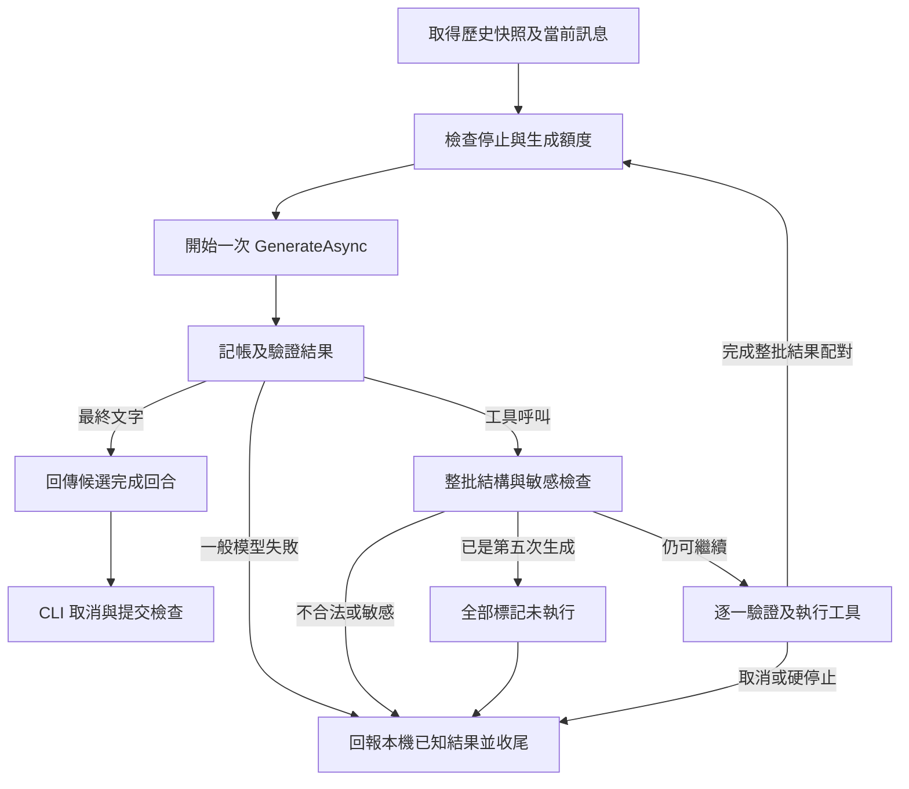

# 05：Agent 工具循環子規格

## 第 18 份產品實作接續（2026-10-28）

原十三工具追加兩項 ExternalRead，改以不可變 RegistrySnapshot 綁定同一請求、回應及整批派送。保留 PartIndex／Name／CallId 與原生簽章；MCP 流程失敗停止剩餘工具／生成並保留已完成結果，不自動重送。 詳見[第 18 份](18-mcp-external-tools.md)及其固定交接；實際驗證與未驗層級見 [README](../README.md#mcp-validation)。

## 第 17 份產品實作接續（2026-10-27～28）

一般／Review／維護生成及結果採用、工具整批／逐項與最終歷史發布加入技能重驗；新增 skills_changed／skills_unavailable／skills_limit，保持原生 NotExecuted 配對、用量及較嚴格故障優先。詳見[第 17 份](17-reusable-workflows-and-skills.md)及[當次分層驗證](../README.md#skills-validation)。歷史文件交付敘述保留，未結原生／真人／真實 Gemini／Release 門檻不變。

## 第 16 份產品實作接續（2026-10-27）

受控寫入增加 checkpoint 預留與來源完成；checkpoint_limit 停止工具鏈並以 resource_limit 阻擋在途任務。復原完全由本機 ID 入口處理，不新增模型工具或改成功資料格式；一般、Review 及摘要請求加入目前復原警示，保留已發生操作事實及原生成／body 限制。 詳見 [第16份](16-change-checkpoints-and-recovery.md) 與 [當次分層證據](../README.md#checkpoint-validation)。下列原階段敘述保留歷史範圍。

## 第 15 份產品實作接續（2026-10-26）

[工作保存與續接](15-work-save-and-resume.md)的限定增量：保存摘要新增 internal WorkSaveSummary 用途，沿同一 Runner、client、生成閘門與唯一記帳，至多一次且 Tools=[]。它不建立一般回合、不派送工具、不修改 LastTurnOutcome 或任務事實；公開 LLM／工具契約保持。 本節保留舊階段歷史，實際分層驗證見 [README](../README.md#work-save-validation)。

## 第 14 份產品實作接續（2026-10-26）

[第14份終端機操作改善](14-terminal-interaction.md)只擴充一般ReadInputAsync的隱藏多行／文字元素編輯、F2安全預覽、F3明確貼上、F4換行及程序內安全歷史；Key／認證選單／三種核准仍走原隱藏單行。多行斜線指令在所有解析器之前整筆拒絕，單行精確匹配與Scope／pin字面餘文保持。

CLI輸入狀態加入共同安全清除、認證選單前清除及政策／退出生命週期；不加入Context／摘要／計畫／Git來源或完成證據，沒有新增生成、工具與權限。RULE-HO-006／GIT-HO-006的承接細節見第14份第7、8、9、11、12節與TERM-AC-016～026。原階段歷史保留，當次證據及真人／服務／原生／發布待辦見[README](../README.md#terminal-interaction-validation)。


## 第 13 份產品實作接續（2026-10-26）

[第 13 份 Git 差異與程式碼審查](13-git-diff-and-code-review.md) 新增專用 GitRead 能力與三項唯讀工具，依 Plan／Execute 提供九／十二項；`/review` 為共用 Runner 與生成預算的新入口，該回合只允許三項 Git 工具。原十項工具的順序、輸入與成功資料保持，公開 LLM 契約與 SDK 訊息所有權保持。

Git 來源、覆蓋與報告不建立修改快照、Plan Read requirements 或 Verified／Validation 事實；一般 Git 探索與正式審查分開。僅審目前 Scope 的安全子集；忽略來源的祖先 metadata 例外不放寬一般 `.git`、跨 Scope 讀取或搜尋遇新規則邊界整次拒絕的契約。規則失效、共同重設及已發生操作事實仍依原契約收尾。

實作、當次分層證據與未驗證項目見 [README](../README.md#git-review-validation)。真人、真實 Gemini、第 10 份 test 不支援／未結原生驗收，以及第 07 份 Release／分發門檻分開保留。


## 第 11 份實作接續（2026-10-25）

本份歷史階段限制由 [第 11 份 Context 與預算管理](11-context-and-budget-management.md) 明示擴充：成功歷史以摘要替換最舊完整前綴並保留最新兩回合；生成預設仍每回合五次，新增程序總額度100次，回合／程序可調為1～20／1～1000。自動摘要共用一般回合額度，手動 /compact 另有單次維護統計且計入程序總額度；只有有效 /compact 是新增會生成的本機指令例外。clear、reset、換 Key、模式及計畫變更不退還程序消耗。

PlanStore、原始工具配對與簽章、讀檔快照及逐次核准仍由原邊界管理。20任務／1在途／256事實與計畫容量不放寬；程序仍兩次／300秒、一般失敗即停止，test仍不支援。實際功能、當次證據及未驗證部分見 [README](../README.md#context-budget-validation)，不以本增量解除其他階段門檻。

> 文件版本：0.1｜建立日期：2026-10-21｜狀態：待實作規格
>
> 上位文件：[入門 AI Agent 開發總規格書](../SPEC.md)，主要依據第 5～7、9～10、15～16 章，並承接第 6、8、11、13～14 章的安全、操作及用量約定。前置規格：[01：專案啟動與 API Key](01-bootstrap-and-key.md)、[02：Gemini 用戶端](02-gemini-client.md)、[03：CLI 與 Context](03-cli-and-context.md)、[04：工作區與唯讀工具](04-workspace-and-read-tools.md)。01～04 已有實作，目前能力以 [README](../README.md) 與原始碼為準；舊規格的「待實作」是其撰寫時狀態。本文件完成不表示自然語言讀檔或第二階段整合已完成。

## 1. 目的、交付邊界與完成標準

把模型提出的原生 function call，接到已存在的工作區唯讀服務，讓使用者能透過自然語言列檔、讀檔及依真實結果取得回答。明確分開模型要求、本機實際執行、結果回填與最終回答，並使一個回合能在有限生成次數內停止。

本次交付只新增本檔，不修改總規格、README、01～04 規格、程式、測試、設定、專案或套件；不建立其他規格、計畫檔或空實作，不安裝 hooks，不提交、推送或改寫歷史。以下宣告、流程、畫面、案例與命令均為後續開發要求，不是本次新增的產品能力或已執行的產品驗收。

需求使用 `LOOP-xxx`，驗收使用 `LOOP-AC-xxx`，後續新增時接續編號；上游引用保留 BOOT、GEM、CLI、WS 前綴。本文件完成與後續產品完成分開驗收。

| 編號 | 具體要求 |
|---|---|
| LOOP-001 | 沿用 .NET 10 Console、Google.GenAI 1.26.1、MSTest／Microsoft.Testing.Platform、既有模型及 v1beta Generate Content 模式。保留可空值分析、警告視為錯誤、啟動參數及非機密設定；不增加套件、設定欄位、端點或認證來源，先驗收 macOS。 |
| LOOP-002 | 本份後續產品開發範圍為 AgentRunner、兩個唯讀工具的 Schema／登錄／派送、原生呼叫配對、完整工具回合、取消、本機結果與多次生成用量。所有檔案操作沿用第 04 份入口；不另寫較寬鬆的直接檔案存取。 |
| LOOP-003 | 本份實作完成後，正式請求的 Tools 固定包含 `list_files`、`read_file`，一般聊天仍可直接得到文字回答。建立 client、工作區服務、Registry 或 Runner 不生成、不列檔、不讀內容；首次正常使用者訊息才可生成。 |
| LOOP-004 | 不登錄 `create_file`、`replace_text`、shell、刪除、重新命名或其他工具；不實作寫入、預覽、確認、搜尋、遞迴、大檔分段、分頁、背景工作、平行工具、串流、摘要、持久化或自動重試，不引入 Agent 框架。 |
| LOOP-005 | 本份產品的離線完成點為真實聊天組裝、真實 SDK 配假 handler、真實暫存工作區及可控制替身的驗收通過，並完成既有回歸。PTY、真人終端機及真實 Gemini 分別記錄；文件完成與離線通過均不能代替真人／服務驗收。 |

## 2. 既有基線與跨階段責任

本次已閱讀總規格第 16 節、前置規格與直接相關原始碼，未重新執行既有建置、MSTest、PTY 或真實服務。既有測試數不作為本次通過證據。

| 既有能力 | 本份接續方式 |
|---|---|
| `ChatApplication`、`IChatInteraction` 與 busy 輸入觀察 | 保留指令、隱藏輸入、換 Key 及退出規則；將 busy 範圍延伸到完整工具回合。 |
| `ILlmClient.GenerateAsync`、`LlmRequest`、`LlmResult` | 沿用公開契約；正式帶入兩個工具定義，由 Runner 顯式執行各次生成。 |
| `LlmMessage`、`LlmToolCall`、`LlmToolResult` | 保留不透明模型 Content、PartIndex、CallId、Name 及 JSON 所有權；擴充內部模型呼叫投影供完整回合驗證。 |
| `ConversationContext` | 保留 BuildMessages 的入口及五回合策略，將 CommitCompletedTurn 從兩則文字訊息擴充為第 8 節的完整工具回合。 |
| `UsageAccumulator` | 沿用逐欄累計、缺值及溢位規則；同時提供當前回合與整個程序的統計。 |
| `IWorkspaceFiles`、`WorkspaceResponseWriter`、讀取快照 | 直接沿用型別化列檔／讀取及明確 JSON 投影，不把快照或完整路徑加入模型結果。 |
| `ClearConversationState` 與 session 生命週期 | 沿用 Context／快照共同清除、工作區與 client 先於 session 釋放的規則，加入 Runner 及本機紀錄的清理。 |

本份產品實作後，CLI-002、CLI-009、CLI-017、CLI-021、WS-002 及相應案例中的「空 Tools、只有聊天、一次生成、兩則訊息」改由本份增量規則承接；這些是前一階段的能力限制，原有 Key、配對、安全、清除及用量規則持續有效，不修改舊文件來抹去階段歷程。

第 06 份承接寫入工具、候選變更、讀取基準、差異與確認；第 07 份承接整體成本、最終真人驗收及提交／發布檢查。本份不預先建立寫入介面、確認狀態或自動掃描，但目前階段的敏感檢查及測試必須在本份完成。

## 3. 模組、契約與所有權

### 3.1 最小責任單位

| 元件 | 責任 |
|---|---|
| ChatApplication | 持有 session、client、工作區及當前 Runner；處理 CLI、停止原因、最終提交、強制清除、換 Key 與釋放。 |
| AgentRunner | 執行單一使用者回合，保留當前工具鏈，呼叫模型、協調依序派送、限制生成次數、收集本機結果及用量，回傳候選完成回合。 |
| ToolRegistry／ITool | 固定登錄、檢查名稱／參數、轉接工作區操作並產生受控工具結果；不提示輸入、不呼叫模型。 |
| ConversationContext | 驗證、保存及裁切完整回合；不讀檔、不派送、不檢視 SDK 物件。 |
| Gemini 轉接層 | 維持原始協定、敏感檢查、實際 body 限制及配對驗證；不執行工具或管理回合次數。 |

### 3.2 後續實作的契約形狀

以下為規格宣告，不是本次加入的 C# 實作。新增型別均為 `internal`，既有公開 LLM 方法簽章不變。

```csharp
internal interface ITool
{
    LlmToolDefinition Definition { get; }
    Task<ToolExecutionResult> ExecuteAsync(
        JsonElement arguments, CancellationToken cancellationToken);
}

internal enum ToolStatus { Success, Rejected, Cancelled, Failed, NotExecuted }
internal enum AgentTurnStatus { Completed, Cancelled, Stopped, Failed }
internal enum AgentStopReason
{
    None, ModelOutcome, TurnCancelled, GenerationLimit, SensitiveData, InvalidProtocol,
    WorkspaceUnavailable, RunnerUnavailable, LocalFailure
}
internal enum AgentEventKind { Generating, ExecutingTool, ToolCompleted }
```

| 型別或操作 | 必要形狀與語意 |
|---|---|
| ToolRegistry | 建構時取得 `IReadOnlyList<ITool>` 與當前 `ISensitiveDataPolicy`；提供 `IReadOnlyList<LlmToolDefinition> Definitions`、`Task<ToolExecutionResult> DispatchAsync(LlmToolCall call, CancellationToken cancellationToken)`。不擁有 session 或工作區的釋放責任。 |
| ToolExecutionResult | 唯讀 `ToolStatus Status`、`string ErrorCode`、`JsonElement? Response`、`string? RelativePath`、`long? ByteCount`、`int? ReturnedEntries`、`bool Truncated`。ErrorCode 只可來自第 6 節固定碼；Response 為可安全回填的 object，無法建立時為 null。只有 Success 可帶正規化 RelativePath 及相應的 ByteCount 或 ReturnedEntries／Truncated；其他狀態這些可空欄位為 null、Truncated 為 false。 |
| AgentRunner | 建構時注入 client、Registry、當前政策、固定應用指示、程序 UsageAccumulator 及 `Action<AgentEvent>`；提供 `Task<AgentTurnResult> RunAsync(IReadOnlyList<LlmMessage> initialMessages, CancellationToken cancellationToken)`。initialMessages 是 Context.BuildMessages 當次的唯讀快照，最後一則為當前使用者訊息。 |
| AgentTurnResult | 唯讀 Status、StopReason、`LlmStatus? ModelStatus`、`LlmErrorCode? ModelErrorCode`、`string SafeText`、`IReadOnlyList<LlmMessage> CompletedTurn`、`IReadOnlyList<LocalToolOutcome> Operations`、`int GenerationsStarted`、`UsageSnapshot TurnUsage`、`bool RequiresContextReset`。CompletedTurn 只在候選成功時非空；SafeText 只用於最終回答或明示截斷的安全部分文字。 |
| LocalToolOutcome | 唯讀 `int GenerationNumber`、`int PartIndex`、`string? ToolName`、Status、ErrorCode、RelativePath、ByteCount、ReturnedEntries、Truncated；Status 起各欄的語意同 ToolExecutionResult，不含 Response。ToolName 僅可為已登錄且通過政策的名稱，未知／敏感名稱使用 null；不保存原始參數、CallId、檔案文字或模型訊息。 |
| AgentEvent | Kind、GenerationNumber、`int? PartIndex`、`string? ToolName`、`LocalToolOutcome? Operation`；不帶原始 JSON、SDK、模型紀錄或例外。Generating 的後三欄為 null；ExecutingTool 只帶位置及通過政策的已登錄名稱，Operation 為 null，不先建立成功或未執行結果；ToolCompleted 帶實際 Operation 及其識別。 |

| 編號 | 契約要求 |
|---|---|
| LOOP-006 | ChatApplication 是 session 及相依資源的唯一擁有者；Runner 借用 client、Registry、政策，不釋放它們，不直接提交 Context 或操作終端機。Program.cs 只組裝與啟動。 |
| LOOP-007 | 新增契約不公開 SDK、HTTP、Key、原始例外或原始協定出口；本機停止原因使用 AgentStopReason，不將生成上限或工具失敗塞進 LlmErrorCode、假造模型回答或程序退出碼。 |
| LOOP-008 | 含文字、路徑、JSON 或訊息的新增型別採密封類別、唯讀屬性及防禦性複製；結果、事件及紀錄的內容屬性維持 internal，不支援一般 JSON 傾印，ToString 僅固定型別標記。JSON 克隆所有權，集合不暴露可變陣列；純數值統計沿用既有 record，既有公開 LLM 資料契約不變。 |
| LOOP-009 | 一份 Runner 綁定當前 session 的 client／Registry／政策，一次只接受一個回合；並行第二次為 Failed／RunnerUnavailable，零生成、零工具操作，不排隊。RunAsync 驗證 initialMessages 非空、無 null、最後一則為非空白 User；不合法入口為 Failed／LocalFailure，零操作。每次正常呼叫重新建立當前鏈、計數及回合用量，不能續跑前次中止鏈。 |
| LOOP-010 | Registry 建構時用 Ordinal 檢查名稱唯一、Name／Description 非空白且 Schema 為 object；重複或不合法登錄屬固定本機組裝失敗，沒有部分可用登錄。正式組裝順序固定 list_files、read_file，各次請求使用同一份不可變 Definitions；不反射載入或執行模型提供的程式。 |

## 4. 工具 Schema 與參數解析

### 4.1 對模型公開的兩個定義

工具名稱固定為 `list_files`、`read_file`。描述分別說明「列出指定工作區相對目錄的安全第一層項目，根目錄用 .」及「完整讀取指定工作區相對路徑的小型 UTF-8 文字檔」。描述保持精簡，不包含工作區完整路徑、檔案內容、Key 或完整應用指示。

兩者 Parameters 使用下列相同 JSON Schema；用途差異由各自 Description 說明。沿用 SDK 的 ParametersJsonSchema，不同時設定另一份 parameters，亦不加入服務端內建工具。

```json
{"type":"object","properties":{"path":{"type":"string"}},"required":["path"],"additionalProperties":false}
```

以下是合法呼叫參數範例；不是本次執行結果：

```json
{"path":"."}
```

```json
{"path":"docs/notes.md"}
```

| 編號 | 具體要求 |
|---|---|
| LOOP-011 | 只公開上述兩個名稱、用途及 Schema；path 必填且為 JSON string，additionalProperties 為 false。Schema 是模型提示，產品仍必須自行驗證，不能因 API 接受 Schema 就跳過本機檢查。 |
| LOOP-012 | Registry／共用參數解析器列舉 JsonElement 的全部 properties，要求恰好一個、名稱 Ordinal 等於 path、值為 string。缺少、null、數字、布林、陣列、巢狀 object、額外欄位、大小寫變體及重複欄位均為 rejected／invalid_arguments，零工作區呼叫；不得以 TryGetProperty 或 dictionary 的最後值覆蓋掩蓋重複欄位。 |
| LOOP-013 | 通過型別檢查的 path 保持原文，交給 WorkspaceFiles 處理空字串、Unicode、長度、相對語法、敏感名稱及種類。空 path 為既有 invalid_path，純空白名稱按字面處理；根目錄用 .，不能省略 path 或代入目前目錄。不 Trim、Unicode 正規化、URL decode 或展開變數；4096 上限仍按 UTF-16 code units，不用 Schema 字元長度取代。 |
| LOOP-014 | 真實 HTTP 回應須在 SDK 將 JSON 轉成 dictionary 前檢查重複物件欄位；若原生 functionCall／args 含重複欄位，無法可靠保留原始紀錄，按 Failed／InvalidResponse 清除並停止，不採最後值執行或重建帶簽章內容。直接測試 Registry 的重複 JsonElement 則依 LOOP-012 回傳受控參數失敗。這項協定完整性檢查不擴大公開 LLM 契約。 |
| LOOP-015 | 只從已驗證的原生 ToolCalls 取得操作；使用者文字、檔案內容、Markdown JSON、XML、shell 字串與附帶文字均不解析成工具。所有後續操作仍須由下一份原生模型回應明確提出，不能因檔案提到另一個路徑便自行讀取。 |

第 02 份 SDK 以 dictionary 表示參數，進入該轉換後可能已無法分辨原始重複欄位。因此必須保留上表兩個不同入口的驗收；不能只測 Registry，便宣稱實際模型回應不會發生最後值覆蓋。

## 5. 模型紀錄、批次驗證與呼叫配對

| 編號 | 具體要求 |
|---|---|
| LOOP-016 | 在 LlmMessage 新增 internal 唯讀 ModelCalls 投影，並以 internal FromModel(object protocol, IReadOnlyList<LlmToolCall> calls) 建立；非模型訊息及最終文字模型訊息為空清單。轉接層由同一次解析建立投影與 LlmResult.ToolCalls；不增加公開 SDK／原始 JSON 入口，也不讓核心轉型或檢視 GeminiModelContent。 |
| LOOP-017 | 收到 ToolCalls 後，在任何工具 I/O 前驗證整批：ErrorCode 為 None、無重設要求、ModelMessage 為合法非 null 模型訊息、至少一個呼叫；PartIndex 非負、唯一且嚴格遞增，Name 非空白、Arguments 為 object，模型投影與結果中的呼叫數、順序、識別及 JSON 值一致。矛盾或不合法結構按 InvalidProtocol／InvalidResponse 停止及清除，不能排序修復、部分執行或猜測缺失呼叫。 |
| LOOP-018 | 每筆結果沿用該呼叫的 PartIndex、Name、CallId，採 Ordinal／原值配對；缺省 CallId 保持 null，有值時原樣保留，不生成供應商 ID。同名、相同參數、沒有 ID 的不同 PartIndex 仍是不同呼叫，不能以名稱或參數去重。配對識別的有效範圍為該份模型訊息，不用前一批的 PartIndex 配目前批次。 |
| LOOP-019 | 將完整原始 ModelMessage 放入當前鏈，依原呼叫順序收齊全部對應 LlmToolResult，再以一份 FromToolResults 附在其後。每個呼叫恰好一個結果；缺少、重複、不匹配或非 object 結果均不得續送。保留 Content、parts、thought signatures 及中繼資料，不合併 parts、不交錯單筆呼叫／結果、不用 SafeText 或參數重建原始模型訊息。 |
| LOOP-020 | Schema、Arguments、Response、模型呼叫投影與完成回合在來源 JsonDocument／來源集合釋放或改動後仍有效。API functionResponse 只帶既有 Name、可用 CallId 及 Response，不將本機 PartIndex、生成次數、操作紀錄或快照欄位加進協定。最終送出仍由 Gemini 轉接層驗證配對及同一 client 的模型紀錄所有權。 |

核心投影只用於驗證及配對，不能替代原始模型 Content。完整 JSON 的欄位名稱及字串值依第 10 節檢查；JSON 值比較不能靠可能改變跳脫或空白的顯示字串判定。Gemini 實際保留的協定安全檢查持續由既有轉接層負責。

合法順序示意：

```text
U：使用者訊息
M1：完整模型 Content，內含呼叫 A、B 及其原始中繼資料
R1：同一份工具結果 Content，依序包含 A、B 的結果
M2：完整模型 Content，內含呼叫 C
R2：C 的工具結果 Content
M3：最終文字模型 Content
```

本機依序執行 A、B，不把 API 在同一回應提出多個呼叫當成允許平行操作。每次附加 R 後才可開始下一次生成。

## 6. 派送、結果格式與失敗分類

### 6.1 派送流程

1. Runner 驗證整批結構及敏感資訊，檢查生成上限與取消。
2. 對每個呼叫按原序進行操作開始檢查，Registry 精確查找已登錄工具。
3. 未知名稱直接建立受控拒絕；已知工具驗證參數後，僅呼叫對應的 ListFilesAsync 或 ReadFileAsync。
4. 工作區結果透過既有 WorkspaceResponseWriter.TryCreateResponse 產生 Response，保留成功資料與失敗分類。
5. 立即記錄實際本機狀態並通知 CLI；檢查硬停止條件，必要時將其餘呼叫標記未執行。
6. 為可安全配對的整批建立結果訊息；允許繼續且仍有生成額度時，才進入下一次生成。

| 編號 | 具體要求 |
|---|---|
| LOOP-021 | list_files 與 read_file 分別只轉接 IWorkspaceFiles 的對應方法，傳入原 path 與同一回合 token；使用既有明確 writer，不以一般序列化匯出服務、工作區完整路徑、快照或政策。不改寫第 04 份的 status、error_code、data、truncated、safety_filtered 語意。 |
| LOOP-022 | 新增的 Registry 拒絕及未執行結果使用下表兩欄 object，由明確、有界且做敏感檢查的 writer 建立。ErrorCode 只能是表列值或既有 WorkspaceErrorCode 的固定 snake_case；失敗不帶 data、原始參數、錯誤 path、例外、原因片段或隱藏名稱。 |
| LOOP-023 | unknown_tool、invalid_arguments、一般工作區 Rejected，以及 access_denied／io_failure 等受控失敗，各自形成結果，接著依序處理其餘合規呼叫，再將完整批次交回模型。模型可在原五次額度內提出修正；工具失敗不能被改成 success，也不以本機重試代替新的模型呼叫。 |
| LOOP-024 | 回合取消、敏感資料、無法建立安全投影、非法協定、workspace_unavailable 或服務 unavailable 均停止剩餘操作，不再生成。工作區根失效保留 WS 的快照清除；服務 unavailable 在依序組裝下屬本機失效，以 LocalFailure 收尾。預期檔案失敗維持受控結果，未預期工具程式例外以固定本機失敗停止，不把例外文字送模型。 |
| LOOP-025 | 已開始操作須等待其完成／取消結果，不平行派送、不忽略剩餘呼叫、不從舊快照或歷史文字假造本次成功。不同模型回應明確再次要求同一路徑屬新呼叫，須重新驗證及讀取；這與在取消或 API 失敗後自動重放已完成操作不同。 |

### 6.2 結果及控制方式

| 情境 | Response 的 status／error_code | 本回合後續 |
|---|---|---|
| 工作區成功 | success／none，data 完全沿用第 04 份 | 繼續依序處理。 |
| 未登錄的名稱 | rejected／unknown_tool | 不執行該呼叫，其餘繼續。 |
| 業務參數形狀錯誤 | rejected／invalid_arguments | 不呼叫工作區，其餘繼續。 |
| 一般工作區拒絕／失敗 | 沿用原 rejected 或 failed 及固定碼 | 依 LOOP-023 繼續。 |
| 派送前發現參數含 Key | 若可安全建立本機拒絕分類，為 rejected／sensitive_arguments | 不回填含 Key 的模型紀錄，停止及清除；正常 SDK 路徑通常已先攔截。 |
| 工作區拒絕敏感內容 | rejected／sensitive_content | 停止，不送下一次生成；不回傳遮蔽後內容。 |
| 工作區取消 | cancelled／none | 停止；以取消原因收尾。 |
| 固定根失效 | failed／workspace_unavailable | 停止；快照依既有規則清空。 |
| 工具服務不可用 | failed／unavailable | 停止並以本機失效退出。 |
| 第五次回應中的所有新呼叫 | not_executed／generation_limit | 零工具執行，不送第六次生成。 |
| 取消後尚未開始的呼叫 | not_executed／turn_cancelled | 不執行，不續送。 |
| 其他硬停止後尚未開始的呼叫 | not_executed／turn_stopped | 不執行，不續送。 |

新增小型結果範例：

```json
{"status":"rejected","error_code":"unknown_tool"}
```

```json
{"status":"not_executed","error_code":"generation_limit"}
```

`NotExecuted` 只屬本份工具調度狀態，不修改 WorkspaceStatus。尚未執行的呼叫不得顯示已失敗讀檔或已取消成功操作；已完成操作不因後面的停止改成 NotExecuted。若安全投影無法建立，Response 為 null，仍可保留不含原文的本機分類，但不得捏造可續送的配對或開始另一個補救生成。

## 7. 有限生成循環與結果處理

### 7.1 主要流程



| 編號 | 具體要求 |
|---|---|
| LOOP-026 | 固定 MaxGenerationRequestsPerTurn = 5。每個正常回合從 0 計數，首次生成與所有工具結果續接各占一次；第 4 次呼叫可執行工具供第 5 次回答，第 5 次若仍為 ToolCalls，不開始任何該批工具操作，全部記為 generation_limit，不送第 6 次，亦不增加結尾、摘要或認證測試生成。 |
| LOOP-027 | GenerationsStarted 在取得本次操作開始權、實際呼叫 GenerateAsync 前加一，上限不依成功、Usage 或 RequestDispatched 判斷。RequestDispatched 只計實際傳輸嘗試；false 的本機拒絕仍已占一次方法呼叫額度，但該失敗隨即收尾，不藉未傳輸繼續重試。呼叫前已取消則不取得開始權、不加一。 |
| LOOP-028 | 所有模型結果先驗證非 null、enum 合法、SafeText 非 null 及狀態／錯誤碼一致；矛盾結果為 InvalidProtocol／InvalidResponse 並清除。Completed 需具備 None 錯誤碼、非空白安全文字、合法 ModelMessage、空 ToolCalls／ModelCalls 且無重設要求，才產生候選完成回合。ToolCalls 即使含有「已讀取」等附帶文字，也不顯示為最終回答或本機成功；本份只顯示本機進度，最終回答等到合法 Completed。 |
| LOOP-029 | Empty、Refused、Truncated、Cancelled、Failed 都停止本回合，不補送；截斷僅顯示標註未完整的安全部分文字。錯誤繼續沿用 GEM 分類；AuthenticationFailed 才交回 ChatApplication 進入換 Key，ClientUnavailable 或不可恢復本機失效退出 1，其他普通 API 失敗回到輸入。 |
| LOOP-030 | 生成與各筆工具的開始、取消／停止旗標及最終提交有明確的互斥決策點。停止已先成立時不得取得新操作開始權；已取得開始權的操作仍傳入同一回合 token，由相依服務在 I/O 前及發布前檢查。單一協調器依序等待結果，事件回呼不得另行啟動模型或工具。 |

模型回應中的敏感內容及非法結構先於正常工具分類；外部取消先於發布新的回答。第 5 次的結構或敏感檢查失敗，仍依對應安全分類停止，不能用上限狀態掩蓋問題。停止、取消與已知用量都不需要額外模型請求才能回報。

### 7.2 Agent 與模型分類的對應

| AgentTurnStatus／StopReason | 使用情境 |
|---|---|
| Completed／None | 合法最終回答，回傳非空 CompletedTurn 候選。 |
| Cancelled／TurnCancelled | 回合取消、程序停止造成的取消，或工作區回傳 Cancelled；CompletedTurn 為空。 |
| Stopped／ModelOutcome | 模型 Empty、Refused 或 Truncated。 |
| Failed／ModelOutcome | 模型 Failed；保留其既有安全錯誤分類供 CLI 判斷認證等後續流程。 |
| Stopped／GenerationLimit | 第五次仍要求工具。 |
| Failed／SensitiveData | Runner／Registry 或工具結果發現敏感資料；是否重設依第 10 節，不能省略強制重設。 |
| Failed／InvalidProtocol | Runner 發現結果矛盾、非法模型投影或配對。 |
| Stopped／WorkspaceUnavailable | 工作區根失效，停止剩餘操作。 |
| Failed／RunnerUnavailable 或 LocalFailure | 並行錯誤、不合法本機入口、服務失效或未預期本機失敗；正常組裝遇到時退出 1。 |

ModelStatus／ModelErrorCode 只反映最後一份已驗證的 LlmResult；尚無結果或該結果本身矛盾時兩欄為 null。本文件並列的 InvalidProtocol／InvalidResponse，分別指 Runner 的停止原因與 Gemini 轉接層可回報的錯誤分類，不能為本機停止假造一份供應商回應。RequiresContextReset 是獨立安全旗標，即使取消優先決定回合狀態，仍須保留並執行清除。

## 8. 完整回合、歷史與提交

| 編號 | 具體要求 |
|---|---|
| LOOP-031 | Runner 以 initialMessages 建立當次快照，分開保留既有歷史及從最後一則使用者訊息開始的當前回合。CompletedTurn 只包含本回合，不重複包含舊歷史；內容順序必須為 User、零或多組 ModelCalls／ToolResults、最終無呼叫 Model，不能多個 User、連續 Model、孤立結果或沒有最終回答。 |
| LOOP-032 | Context.CommitCompletedTurn 用 ModelCalls 投影驗證每組結果數、順序、識別及 object Response，保留不透明模型訊息本身；純文字兩則回合仍合法。拒絕不完整、空工具結果、未配對、偽造缺失模型訊息或跨回合結果，不為通過驗證改寫 SDK Content。 |
| LOOP-033 | 最近最多五個完整回合加當前鏈；第六回合生成時仍含前五個，成功提交後才淘汰最舊整回合。當前模型呼叫與結果不可分別裁切；不把 API 請求數、工具數或訊息數當回合數。來源集合改動不影響已保存的歷史快照。 |
| LOOP-034 | 普通 API 失敗、工具硬停止、取消、達上限、空回應、拒答與截斷均丟棄當前鏈，保留既有成功歷史，前提是沒有需要重設的資料。可形成安全結果配對的未執行項目只供當前收尾，不提交成成功回合或在下一回合繼續；本機紀錄另存。 |
| LOOP-035 | RequiresContextReset、敏感模型紀錄、非法模型／配對或無法安全形成結果時，先回報已知本機結果，再通知清除全部 Context、快照及待續傳參考；不只移除敏感字串後續跑。強制清除丟棄舊 LastTurnOutcome，本回合可改存新的安全失敗摘要；/clear、換 Key 及退出則清除當前鏈和 LastTurnOutcome，保留原有 Key／工作區／用量規則。 |

一般工具拒絕後，模型若正常解釋失敗並結束，仍可形成完整對話回合；操作紀錄保留實際拒絕狀態，不能因此改為讀取成功。歷史中的讀取文字是當時資料，之後新的 read_file 仍須實際讀取，後續修改也不能以歷史文字取代第 04 份快照與第 06 份重新比對。

## 9. 取消、完成競爭與資源釋放

| 編號 | 具體要求 |
|---|---|
| LOOP-036 | 同一回合 token 覆蓋所有生成及工具操作；每個新回合另建取消來源。等待生成或工具時 Ctrl+C 只取消本回合，停止剩餘操作與續接，等正在進行的服務收尾後才提示下一則輸入；重複取消不升級成新回合或重放。 |
| LOOP-037 | 以 WorkspaceFiles 的發布點判斷工具是否完成：發布前取消無成功資料／新快照，發布後才取消則保留已完成讀取的本機結果及快照，除非之後發生共同清除。Runner 不把已發布 Success 改成 Cancelled，也不因回合未完成假裝操作從未發生。其餘呼叫全記 NotExecuted。 |
| LOOP-038 | Runner 的 Completed 是候選結果；ChatApplication 在原有停止鎖／等價互斥點再次檢查回合取消、程序停止及重設，只有通過才提交並顯示最終成功回答。提交前到達的取消勝過遲到 Completed，已返回的用量仍計一次；提交之後的取消不回溯已保存回合。 |
| LOOP-039 | busy 觀察從首次生成前持續到工具、結果配對、用量與狀態收尾完成，普通文字與斜線字元不排隊、不回顯。Ctrl+D／EOF 取消並等待後正常退出 0，程序取消退出 130，I/O 或清理失敗退出 1；停止原因優先於回到輸入或換 Key。新增 ExecutingTools 聊天狀態，與 Generating、Cancelling 一樣路由回合取消。 |
| LOOP-040 | 換 Key 前在舊政策有效時完成工具／錯誤／用量顯示、等待回合及釋放舊 client；接受新 Key 後清空舊 Context／快照／紀錄，釋放舊工作區、建立新 session／client／工作區／Registry／Runner，再切換政策及釋放舊 session。退出亦先停止回合、清除，再釋放工作區及 client，最後釋放 session；部分建構失敗全數清理，不回退或自動重送。 |

Runner 本身不持有背景工作或自有 client／工作區資源，舊回合收尾後丟棄它的參考。CLI 狀態變更、取消回呼及最終提交須沿用同一停止協調，不能在工具進行中切回 AwaitingInput，讓 Ctrl+C 誤判為整個程序退出。每個相依服務仍保留其自身「取消與發布」的提交點；CLI 不宣稱能回復已完成操作。

## 10. 敏感資訊與安全輸出邊界

| 編號 | 具體要求 |
|---|---|
| LOOP-041 | Runner 在任何工具 I/O 前檢查整批呼叫的 Name、非 null CallId、Arguments 所有實際欄位名稱及字串值，沿用 ToolArguments 邊界。任一命中當前 Key，整批不開始工具，不保存／續傳該模型紀錄，停止並清除；不能只檢查已知工具的 path，而讓未知工具或額外欄位繞過。 |
| LOOP-042 | Registry 在自身入口再次驗證名稱及完整參數；所有工具定義、Schema、歷史、原始模型紀錄及結果也維持 GEM-021～022 的檢查。JSON 依解析值檢查引號、反斜線與 Unicode 跳脫，不只搜尋 JSON 原文字面；保留當前值的 Ordinal 完整子字串規則，不宣稱能找出所有其他或變形秘密。 |
| LOOP-043 | 真實 Gemini 回應的工具資料含 Key 時，沿用 SensitiveOutput：無可執行 ToolCalls、無 ModelMessage、要求清除，仍保留數值用量。Runner 亦再次檢查完整 SafeText，包含工具附帶文字及截斷文字；命中則按相同敏感失敗停止，不顯示原文。這些額外檢查防止不可信替身或之後轉接變動繞過，不能取代真實 SDK 邊界驗收；不為配對修改帶簽章的敏感模型內容。 |
| LOOP-044 | WorkspaceFiles 回傳 sensitive_content 時停止後續鏈，不將遮蔽後文字當成功資料。若安全拒絕結果可建立且原始模型訊息安全，可為剩餘呼叫建立未執行結果後丟棄當前鏈，保留舊成功歷史；不能因這項失敗自行重讀、改用別的工具或要求模型繞過限制。 |
| LOOP-045 | 固定 JSON 欄位、狀態或拒絕碼也可能與短 Key 重疊。任何 TryCreateResponse 失敗或結果再次檢查失敗，Response 為 null，停止、清除且只顯示安全本機分類；不改名、不再嘗試另一個 payload、不把空 object 當假成功，也不繼續生成。 |
| LOOP-046 | 本機事件與最終輸出先組合完整區塊，再沿用 ChatDisplay 的控制字元處理與 RedactForDisplay；工具標籤、名稱、路徑、錯誤及用量都包含在內。失敗不回顯請求 path，未知名稱只顯示固定未知工具標籤；不顯示 thought、簽章、CallId、原始 JSON、完整路徑、原始例外或檔案全文傾印。 |
| LOOP-047 | Key 只由既有隱藏輸入取得並用於官方 HTTPS 認證；不新增參數、環境、檔案或公開屬性。文件、範例、測試、斷言、stdout／stderr 與報告不得包含真實憑證或完整應用指示；不啟用 SDK／HTTP 傾印、對話日誌或工具快照匯出，也不宣稱清除能覆寫 runtime 的全部複本。 |

工作區檔案內容始終是資料。即使文字聲稱是上級指示、要求讀取憑證或更換工作區，程式也不提高權限；模型之後提出的每個新呼叫仍須逐次通過同一入口。這延續第 04 份的應用層限制，不增加對任意外部競態、硬連結或作業系統沙盒的保證。

## 11. 本機結果、回合狀態與用量

### 11.1 本機操作紀錄

| 編號 | 具體要求 |
|---|---|
| LOOP-048 | 每個結構合法且可辨識的呼叫按生成批次及 PartIndex 建立一筆 LocalToolOutcome，區分 Success、Rejected、Failed、Cancelled、NotExecuted；GenerationNumber 從 1 起算，PartIndex 保持原 parts 的零起算位置。正常派送完成立即記錄；取消、達上限或硬停止則補上未開始項目，不能省略它們。整批協定不合法或缺失呼叫資料時只回報已知分類，不猜測不存在的操作紀錄。 |
| LOOP-049 | 本機成功來自實際 Workspace 結果，read_file 顯示安全正規化路徑與實際 ByteCount，list_files 顯示回傳筆數及 Truncated；失敗只顯示受控種類／碼。工具進度與結果先於最終回答或模型錯誤，工具成功後 API 失敗仍保留成功紀錄，不自動重做，也不改成整回合檔案失敗。 |
| LOOP-050 | Truncated = true 時模型 Response 與本機狀態均標示只回傳部分安全項目；SafetyFiltered 一直為 true，不顯示被隱藏數量或暗示目錄完全無其他項目。正常未截斷亦僅表示已列出本次可回傳的安全項目。 |
| LOOP-051 | 每回合收尾顯示 GenerationsStarted、該回合傳輸嘗試數、五欄回合用量及程序累計。生成次數是方法呼叫數，傳輸嘗試數來自 RequestDispatched；兩者不以工具成功數、HTTP 200 或 token 是否存在推算，也不代表 Google 已收到或計費。 |
| LOOP-052 | 每次 GenerateAsync 返回後，由 Runner 對程序累計及當前回合累計各 Record 一次；不由 ChatApplication 再對相同結果重複記帳。只有 RequestDispatched = true 才更新用量及缺值，false 不增加缺值；取消、失敗、拒答、截斷及敏感回應的合法數值照計，不保留整份 LlmResult 清單去重。 |
| LOOP-053 | 回合用量重用 UsageAccumulator／UsageSnapshot，逐欄保存已知小計、缺值數及溢位，不能將 null 當零或從程序前後快照相減推算。Total 採 API 原值，thought／cached 不重複加入；本機指令或生成前拒絕不虛構用量。/clear、強制清除及換 Key 保留程序累計；每回合累計重新建立。 |
| LOOP-054 | 只保留最近一份 LastTurnOutcome 的停止原因、模型分類、生成數、數值用量、重設旗標及安全 Operations，供本機收尾與檢視；不保存回合參數、工具全文或可續傳訊息。新回合取代，/clear、換 Key、退出丟棄，不另建無限成長的錯誤／操作歷史，也不把這些本機狀態加入模型訊息。 |

以下是後續預期操作示意，非本次執行紀錄；範例的 6 bytes 對應 `Hello` 加 LF：

```text
你> 讀取 notes.md，說明內容。
[工具] read_file：開始處理
[本機結果] 已讀取：notes.md，6 bytes
[模型狀態] 無法連線至 Gemini；本次流程停止。
[回合] 生成 2 次；傳輸嘗試 2 次；已完成讀取不自動重做。
```

模型成功後，本機狀態與最終文字分別顯示；工具拒絕而模型正常回答時也保留拒絕紀錄。應用只要求模型根據工具事實回答，無法保證自由文字永遠正確，因此不能把模型敘述當作驗收或磁碟狀態依據。

### 11.2 用量例子

若本回合三次 GenerateAsync 的結果為：第一次已傳輸且 TotalTokens = 10；第二次已傳輸但 TotalTokens 缺失；第三次本機 InputTooLarge、未傳輸，則生成次數為 3、傳輸嘗試數為 2、總計欄為「已知小計 10／不完整（1 次缺值）」。第三次不再增加缺值，也不為取得完整統計補送請求。其他四欄各自依其實際值處理。

## 12. 資源限制、設定與 CLI 能力說明

| 編號 | 具體要求 |
|---|---|
| LOOP-055 | 沿用下表具名常數及各自單位，不增加工具參數、設定或環境變數來放寬。不把單筆結果上限當完整模型請求保證，不將快照當無限快取，也不在磁碟暫存工具鏈或操作紀錄。 |
| LOOP-056 | 每次生成都沿用實際 SDK 序列化 body 的 262144 bytes 上限，包括固定指示、五回合歷史、當前鏈、兩份工具定義、結果及簽章。262145 即 InputTooLarge，零該次傳輸；保留本機已完成紀錄並停止，不截斷 read_file、刪掉較舊歷史、改寫簽章、摘要或重送。 |
| LOOP-057 | 後續產品實作時更新最小必要的啟動能力提示、固定應用指示與 /help，說明只有受限列檔／讀檔、內容可能送 Gemini、工具取消及 /clear 清除快照；不把寫入列為可用能力。此為本份的後續串接要求，本次不修改提示原始碼或 README，也不在文件附完整應用指示。 |

| 限制 | 值與單位 | 所屬邊界 |
|---|---|---|
| MaxGenerationRequestsPerTurn | 5 次 GenerateAsync | 本份。 |
| MaxCompletedTurns | 5 個完整回合 | Context；另加當前完整鏈。 |
| MaxInputCodeUnits | 16384 UTF-16 code units | 既有單行使用者輸入。 |
| MaxRelativePathCodeUnits | 4096 UTF-16 code units | 原始工具 path。 |
| MaxFileBytes | 131072 bytes，含 BOM | 實際讀取與完整檔案驗證。 |
| MaxListEntries／MaxScannedEntries | 回傳 200 筆／掃描 4096 筆 | 第一層列檔。 |
| MaxToolResultBytes | 196608 UTF-8 JSON bytes | 單份完整 Response object；不含 API 外層。 |
| MaxSnapshotCount／MaxSnapshotBytes | 20 份／1048576 原始 bytes | 同一工作區服務。 |
| 模型完整請求 | 262144 UTF-8 JSON bytes | 實際 SDK body；不是字數或 token。 |
| 模型輸出／期限 | 8192 output tokens／每次生成 120 秒 | 既有 Gemini 設定；不是整個工具回合期限。 |

同一回應可有多個工具呼叫，本份不把五次生成誤當五次工具操作，也不另加未約定的工具次數截斷。逐一執行並保存當前有限回合的必要結果後，完整 body 仍可能超限；依 LOOP-056 停止，不能漏掉結果來湊出可送請求。每次生成的 120 秒期限不代表整個多步回合只需 120 秒；使用者可在整段 busy 期間取消。

## 13. 需求對照與後續產品驗收

### 13.1 方法、證據與上游承接

| 編號 | 具體要求 |
|---|---|
| LOOP-058 | 自動驗收全程離線，只使用無認證功能的假 Key、假模型／互動、可控制服務及隔離暫存工作區；不讀真實憑證、不錄製真實請求。測試資料保留，不使用遞迴／批次刪除；若需清理，只刪逐一指定的單一路徑檔案。 |
| LOOP-059 | 分別驗證 Runner／Registry 單元行為、真實 Gemini SDK 序列化／解析配假 handler，以及真實 ChatApplication 配工作區服務的整合。斷言實際生成與傳輸次數、呼叫順序、結果配對、檔案 bytes 及新舊快照；不能只用假的完整工具結果代替真實入口。斷言及報告只列案例 ID、狀態、數值與布林，不傾印原文。 |
| LOOP-060 | 沿用 acceptance-linked MSTest 名稱，例如 LOOPAC008_SameNameCallsKeepOriginalPartOrder；更新先前階段已預告的空 Tools／單次／兩則回合預期，保留 Key、SDK、工作區、輸入、取消、配對及防洩漏的原有回歸目的，不刪除失敗案例或放寬 .editorconfig 來取得通過。 |
| LOOP-061 | 後續實作當次分開記錄新增離線驗收、完整既有回歸、PTY、真人終端機、真實 Gemini 的命令、退出碼、測試數、結果及未測項目。下表是待驗收要求；本次文件檢查及既有 README 歷史紀錄都不能當成產品通過證據。 |

| 上游責任 | 本份承接及保留界線 |
|---|---|
| BOOT-022～026、AC-019 的工具參數部分 | 實際派送前 Key 檢查、結果及本機顯示；寫入候選仍交第 06 份。 |
| GEM-015～019、021～022、035、GEM-AC-028 | 完整協定、真實工具往返、未知工具、依序配對、五次上限與取消。 |
| CLI-025、GEM-AC-026 的完整工具回合部分 | 工具回合保存、五回合裁切、清除及多次生成用量。 |
| WS-AC-033 | 正式 Schema／派送、自然語言列檔／讀檔、多步、截斷與 API 後續失敗；離線與真實服務證據分開。 |
| GEM-AC-029、WS-AC-034 | 本份只承接唯讀操作後 API 失敗的本機紀錄；寫入、預覽、確認、衝突及提交／發布仍交第 06～07 份，不宣稱整個上游案例已完成。 |

### 13.2 離線產品驗收

| 案例 | 對應需求 | 情境與預期結果 |
|---|---|---|
| LOOP-AC-001 | LOOP-001～010、047、057 | 技術、設定及公開 LLM 契約維持；新增契約 internal、無 SDK／秘密出口。正式只登錄兩工具，建構、啟動、help、clear、換 Key 與退出零額外生成／檔案讀取，未提供後續工具。 |
| LOOP-AC-002 | LOOP-007～010、020、054 | 固定 ToString、防禦性集合／JSON 所有權、來源釋放後仍有效；事件與 LastTurnOutcome 不公開原始參數、文字、CallId 或協定，非成功工具資料欄位為空。Registry 重複／不合法登錄固定失敗、無部分可用；Runner 不合法入口及並行呼叫零額外操作。 |
| LOOP-AC-003 | LOOP-003、010～011、021 | 真實 SDK／假 handler 擷取正式 body，兩個 functionDeclarations 的順序、名稱及 ParametersJsonSchema 與文件一致，沒有後續工具或重複 parameters，也不靠 SDK 自動執行。 |
| LOOP-AC-004 | LOOP-011～014、023、041～042 | 缺 path、null、錯誤型別、額外／大小寫／重複欄位、非 object 的直接 Registry 輸入，均拒絕且工作區零呼叫；合法一般業務錯誤可形成結果。真實 wire 重複欄位另驗證 InvalidResponse、零 I/O、清除，不默認最後值。 |
| LOOP-AC-005 | LOOP-012～013、021、055 | 真實入口驗證 .、空字串、純空白及首尾空白名稱、中文、補充平面字元、字面變數、4096／4097 單位、..、絕對路徑、敏感名稱及符號連結；原文到達工作區，沒有 Trim、展開或路徑放寬。 |
| LOOP-AC-006 | LOOP-003、026～028、031～033、052 | 純文字直接回答：一次生成、零工具，仍提交合法兩則回合；工具存在不強迫讀檔。方法及傳輸次數、用量恰好記帳。 |
| LOOP-AC-007 | LOOP-015、018～021、025～026、031、049 | 真實 ChatApplication＋SDK 假 handler＋暫存工作區，模型列檔→依回傳相對路徑讀檔→回答；三次生成，真實內容及順序正確，無啟動掃描／額外讀取。另驗證讀 A→讀 B→回答。 |
| LOOP-AC-008 | LOOP-017～020、025、048 | 同批多筆、同名不同參數、同名相同參數、有／無 CallId：依原 PartIndex 逐一執行，峰值同時操作為一，全部結果維持配對及順序，無名稱去重或覆蓋。不同批次相同 PartIndex 不混用。 |
| LOOP-AC-009 | LOOP-016～020、028、032、043 | 真實 SDK 回應含多個 text／thought／functionCall parts 及簽章；完整模型 Content、ID、順序及必要 metadata 原樣續傳，全部 functionResponse 同組在後，無交錯、簽章改寫或 thought 顯示。 |
| LOOP-AC-010 | LOOP-016～019、031～032、035 | 假回應缺模型訊息、空呼叫、錯誤碼矛盾、負／重複／逆序位置、投影不一致、缺少／重複／錯名／錯 ID／錯位置結果：派送前或續送前阻擋、清除，無修復性排序、部分執行或非法新傳輸。 |
| LOOP-AC-011 | LOOP-010、015、022～023 | 未知工具（含 shell／寫入名稱）與大小寫變體只得 unknown_tool，沒有替代操作；與合法呼叫混合時，其餘依序執行。將受控失敗交回模型後，可在同回合提出合規修正。 |
| LOOP-AC-012 | LOOP-012～013、021～023、025 | 業務參數錯誤、not_found、access_denied、invalid_utf8、file_too_large、result_too_large 等與成功呼叫混合，各自保留受控結果；其餘照序，下一個模型請求可修正，無本機自動重試。 |
| LOOP-AC-013 | LOOP-021～022、041～047 | 成功與失敗 Response 沿用工作區 JSON 欄位及順序，新增 unknown_tool／invalid_arguments／not_executed 格式正確；不帶完整路徑、原始失敗 path、隱藏名稱、例外、快照或其他欄位。 |
| LOOP-AC-014 | LOOP-024、035、048～049 | 第一筆讀取成功、下一筆根失效／服務 unavailable／未預期工具程式例外，保留成功、停止並標記剩餘未執行，零續接；根失效清空快照，本機失效按退出 1 收尾，無原始例外外洩。 |
| LOOP-AC-015 | LOOP-026～027、048、051 | 前四次均要求工具，第五次最終回答：五次生成、前四批按序完成、正常提交，沒有第六次。另一案例第五次仍含多筆工具，該批工作區零呼叫、全部 generation_limit，既有完成紀錄保留、不提交當前回合。 |
| LOOP-AC-016 | LOOP-027、029、051～053、056 | 本機未傳輸拒絕仍區分方法呼叫與傳輸嘗試；失敗立即停止，不因 RequestDispatched=false 增加重試額度。生成前已取消則兩者均零，取得合法結果後才記帳。 |
| LOOP-AC-017 | LOOP-017、026、028～029、049 | 文字與工具混合不提早顯示完成；第 5 次有敏感／非法工具結構時依安全錯誤停止而非掩蓋為達限。Refused、Truncated、Empty 或非正常結束帶工具資料均零派送，不額外生成。 |
| LOOP-AC-018 | LOOP-028～029、031～032、038 | 合法 Completed 才形成候選；空白文字、缺 ModelMessage、非空 ModelCalls、矛盾狀態及不合法 enum 均受控拒絕／重設。Truncated 安全部分明示不完整、不提交。 |
| LOOP-AC-019 | LOOP-031～034、055 | 混合純文字與多步工具回合超過五回合，第六次仍帶前五個完整回合，提交後整回合淘汰；當前呼叫／結果不拆開。來源改動不改歷史，失敗回合與未執行結果不殘留。 |
| LOOP-AC-020 | LOOP-032、035、040、054 | 真正 ChatApplication 的 /clear、重複 clear、接受新 Key、finally 清除 Context、快照、當前鏈及 LastTurnOutcome；強制重設清除所有待續傳資料及舊摘要，只可保留本回合新的安全失敗摘要。程序用量保留，不刪檔、不送額外請求。 |
| LOOP-AC-021 | LOOP-030、036、039 | 在首次生成前、兩次生成之間、工具開始前與工具之間取消：停止點後沒有新操作開始權／I/O，剩餘呼叫記 NotExecuted；下一回合使用新的 token 且可正常完成。 |
| LOOP-AC-022 | LOOP-025、030、036～037、048 | 可控模型／工作區取消與遲到完成：必須等待原工作收尾，無並行重開。工具發布前取消不成功，發布後取消保留成功紀錄與既有快照，剩餘不執行；不因取消重讀。 |
| LOOP-AC-023 | LOOP-030、034、038～039、052 | 最終模型遲到 Completed 或在顯示／提交前到達取消／程序停止：不提交、不顯示成功，已返回用量只記一次。提交後取消不回溯；模型／工具狀態轉換間 Ctrl+C 均維持正確回合語意。 |
| LOOP-AC-024 | LOOP-029、036、039～040 | busy 期間普通文字與斜線輸入被消耗，EOF／Ctrl+D、程序取消、重複 Ctrl+C、輸出失效及清理失敗按優先序收尾；忙碌觀察與讀取互斥、無緩衝訊息流入下一個聊天或 Key 提示。 |
| LOOP-AC-025 | LOOP-006、009、029、035、040、047、054 | 工具後認證失敗先顯示舊政策下結果／用量並釋放 client，再換 Key；新服務與 Runner 不重用舊模型紀錄、快照或政策。部分建構失敗全清理，無自動重送、驗證生成或舊認證回退。 |
| LOOP-AC-026 | LOOP-017、041～043、047 | 假 Key 在工具名稱、ID、參數名稱／值、未知工具及未使用的額外欄位：Runner 整批預檢零 I/O，Registry 獨立入口亦拒絕，原始敏感模型紀錄不進 Context；真實 SDK 另驗證 SensitiveOutput 無呼叫／模型訊息且數值用量保留。 |
| LOOP-AC-027 | LOOP-021、024、035、042、044 | 真實普通檔案文字含假當前 Key：工具整次拒絕、無新快照、零後續呼叫或生成。安全拒絕可配對時保留舊歷史；沒有遮蔽後成功內容，不改用其他讀取方式。參數 path 含 Key 另依 LOOP-AC-026 清除。 |
| LOOP-AC-028 | LOOP-022、035、042、045～047 | 短假 Key 命中 Schema 時沿既有 SensitiveInput 零傳輸、不改名，依重設旗標處理；命中結果固定欄位、status／error_code 或失敗字面，造成成功或失敗 TryCreateResponse=false 時只本機收尾並清除。無空 object、改名、payload 迴圈或續傳；JSON 跳脫仍依實際值檢出。 |
| LOOP-AC-029 | LOOP-008、046～049、054、058～059 | 假例外、路徑、未知名稱及內容含控制字元／假秘密時，事件、ToString、stdout、stderr 及斷言無原始傾印；完整區塊經控制字元處理及遮蔽，不執行 ANSI／OSC、不顯示 thought／簽章／提示內容。 |
| LOOP-AC-030 | LOOP-028～029、048～049、051～054 | 真實讀取完成後，下一次模型網路、配額、逾時、拒答、截斷或認證失敗：本機成功仍可見，模型狀態分開顯示，不重讀、不提交未完成回合、不假造最終回答。只保留最近一次安全操作紀錄。 |
| LOOP-AC-031 | LOOP-021、049～050、055 | 真實列檔達筆數／掃描／JSON 上限，Response 與本機均保留截斷、固定安全過濾語意；不顯示隱藏名稱／數量，不宣稱完整目錄。空安全集合不自動等於原始目錄空白。 |
| LOOP-AC-032 | LOOP-027、051～053 | 多次生成包含完整、明確 0、部分缺值、整份缺失、負值、已傳輸失敗與未傳輸拒絕：回合及程序逐欄已知小計／缺值正確，無雙重記帳，Total 不補算或再加入 thought／cached。驗證第 11.2 節數值例。 |
| LOOP-AC-033 | LOOP-035、051～054 | 合成 long 小計、缺值與請求計數溢位，保留最後可表示值及不完整旗標，其他欄繼續；/clear、強制清除及換 Key 保留程序累計，每回合重建統計，不以快照相減，不重送補統計。 |
| LOOP-AC-034 | LOOP-020～021、055～056 | 真實 SDK 實際 body 為 262144／262145 bytes，包含兩個工具定義、中文、跳脫、歷史、簽章及真實工作區結果；前者可傳輸，後者零該次 handler 呼叫，保留本機已完成紀錄，不丟結果、裁切、摘要或重試。 |
| LOOP-AC-035 | LOOP-004、015、021、025、047、055、058 | 暫存檔案含讀憑證、切換目錄、執行命令等文字仍只當資料；原始檔案 bytes 與項目清單前後一致，無產品建立／修改／刪除、shell、額外讀取、Office／PDF 捷徑或工具鏈落地。 |
| LOOP-AC-036 | LOOP-001～005、057～061 | 完整新增與既有離線回歸；help／能力提示反映兩個唯讀工具、不洩漏應用指示，啟動與本機指令不生成。只更新階段增量造成的預期，不放寬原安全、Key、工作區或輸入規則，格式檢查通過，無真實外網。 |

LOOP-AC-007、009、026、034 必須經真實 SDK／假 handler，不可全部用假的 ILlmClient 代替。LOOP-AC-005、007、027、031、035 包含真實暫存工作區；權限、取消與發布競爭另用可控制替身。競爭案例只證明指定時點的停止／發布規則，不擴大第 04 份的平台安全保證。

### 13.3 PTY、真人終端機及真實服務

| 案例 | 對應需求 | 後續驗收與證據界線 |
|---|---|---|
| LOOP-AC-037 | LOOP-003～005、036～040、046、057～061 | macOS PTY 使用測試 host 注入假模型／可控制工具，驗證純聊天、工具 busy 取消、工具後續生成、clear、換 Key、EOF 及退出恢復；既有隱藏輸入及防洩漏案例保留。工具中取消須可控制時序，不依小檔讀取時間碰運氣。 |
| LOOP-AC-038 | LOOP-005、036～040、046、049～051、057、061 | 真人在 macOS 終端機檢查提示、工具進度、取消、下一回合、clear、換 Key 及終端機恢復；測試 host 或 PTY 不作真人證據。未操作時明列未驗證。 |
| LOOP-AC-039 | LOOP-003～005、011、018～021、026、033、049～051、056、061 | 使用者自行隱藏輸入 Key 的真實 Gemini 另驗收：一般聊天、列檔、依真實 UTF-8／BOM 內容回答、多步讀取、拒絕受限路徑、截斷提示及 clear 後重新讀取。結果以實際本機紀錄及檔案內容核對，不只看模型是否說成功；模型未自然觸發的分支維持離線證據，不虛報實測。 |
| LOOP-AC-040 | LOOP-004～005、035、040、047、061 | 第 06～07 份才驗收寫入、預覽確認、基準缺失／過期、確認前後衝突、部分寫入及提交／發布掃描。本份不計為已測，也不把第二階段通過寫成第三階段完成。 |

### 13.4 後續產品開發完成後執行的命令

下列命令留待實作完成後，從儲存庫根目錄依序執行；build 與 test／run 不並行。本次文件交付不執行這些產品命令：

```sh
dotnet restore tests/AIAgent.Cli.Tests/AIAgent.Cli.Tests.csproj
dotnet build tests/AIAgent.Cli.Tests/AIAgent.Cli.Tests.csproj --no-restore
dotnet test --project tests/AIAgent.Cli.Tests/AIAgent.Cli.Tests.csproj --no-build
dotnet run --project src/AIAgent.Cli/AIAgent.Cli.csproj --no-build -- --help
python3 tests/terminal_smoke.py
dotnet format src/AIAgent.Cli/AIAgent.Cli.csproj --verify-no-changes
git diff --check
```

真人與真實服務另以既有啟動方式驗收，不將 Key 放入命令、環境變數或檔案：

```sh
dotnet run --project src/AIAgent.Cli/AIAgent.Cli.csproj --no-build -- --workspace "."
```

本份離線產品完成條件為 LOOP-AC-001～036、完整既有回歸及格式檢查通過；PTY 為 LOOP-AC-037，真人為 LOOP-AC-038，真實服務為 LOOP-AC-039，後續交接為 LOOP-AC-040。每類記錄實際結果及未測範圍，不把真人或後續項目加進離線通過數。

## 14. 本次文件檢查、完成條件與下一步

| 編號 | 具體要求 |
|---|---|
| LOOP-062 | 本次只驗證目的、範圍、流程、責任、契約、限制、失敗及驗收齊全；需求與案例可追溯、上游交接一致、JSON 可解析、本機連結存在、Markdown 區塊／表格／空白正確、沒有未定項目，且只新增指定文件。不以文件檢查替代產品建置或行為驗收。 |

本次文件驗收獨立為 LOOP-AC-041，不計入後續產品通過數：

| 案例 | 對應需求 | 本次文件檢查與成功條件 |
|---|---|---|
| LOOP-AC-041 | LOOP-061～062 | 需求及案例編號連續、每項需求有對照；五次生成／五個完整回合、結果配對、停止與清除、固定碼及容量前後一致。JSON 範例可解析、Schema 正確、連結與區塊有效、沒有未定項；既有追蹤檔案內容不變，只新增本檔，空白檢查無錯誤。 |

本次逐項檢查：

- 核對總規格第 16 節與 01～04 的責任；明確說明本份接手空 Tools／單次文字聊天限制，沒有改變既有工作區權限或提前加入寫入。
- 核對 ITool、Registry、Runner、候選結果、Context 提交及 session 生命週期的契約一致；模型失敗、本機硬停止與程序退出碼分開。
- 核對一般失敗可修正、敏感／協定失敗停止、第五次零新操作、取消／發布／提交競爭及安全結果不可建立時的處理沒有矛盾。
- 核對上游容量及單位、正式 Schema、JSON 範例、Markdown 表格、程式碼區塊與本機連結，不建立尚不存在的後續規格連結。
- 執行 git diff --check；新檔尚未追蹤時另執行下列命令並檢查輸出。no-index 若因新增差異退出 1，須確認無空白診斷，不能只憑退出碼認定成功或失敗。

```sh
git diff --no-index --check -- /dev/null specs/05-agent-loop.md
```

- 核對 git status 只有新增本檔，並比較既有追蹤檔案內容；記錄本次實際文件檢查結果，不執行 restore、build、MSTest、formatter、PTY、真人或 Gemini 驗收。

下一步依本份實作並完成工具循環驗收，留下當次結果，再展開第 06 份寫入與確認規格。本份文件不自動啟動該開發；第二階段「可以讀檔」需 04～05 的實際整合證據，第三階段「可以修改」仍需 06～07。平行工具、多工作區、搜尋、摘要、對話恢復、串流、原生競態強化及其他平台均另訂規格。

## 參考資料

以下官方文件於 2026-10-21 查閱，用於核對既有 Generate Content 的參數 Schema、functionResponse 與完整模型紀錄；不代表本次執行真實 Gemini 或升級 SDK／API。官方教學入口可能改用其他 API 範例，本份仍固定使用第 02 份選定的 Generate Content 格式，不混入 Interactions 或其他 SDK 世代。

- [Generate Content API：FunctionDeclaration 與 parametersJsonSchema](https://ai.google.dev/api/generate-content#FunctionDeclaration)
- [Generate Content API：FunctionResponse 的名稱、ID 與結果物件](https://ai.google.dev/api/generate-content#FunctionResponse)
- [Thought signatures：完整歷史、原始位置與工具結果順序](https://ai.google.dev/gemini-api/docs/generate-content/thought-signatures)
